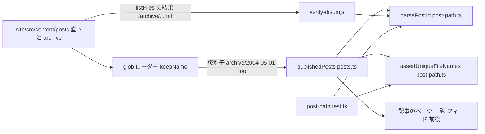
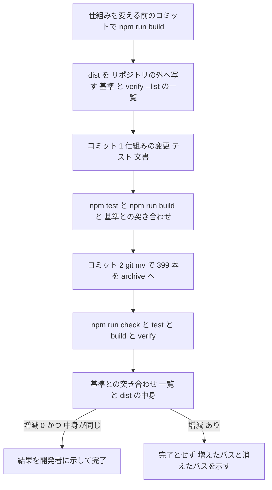

# Design Document: posts-archive-folder

## Overview

**Purpose**: 記事の置き場 `site/src/content/posts/` の下のどのフォルダにも記事を置けるようにし、2010 年までの記事 399 本を `posts/archive/` へ移す。開発者は、新しい記事を書くときに、古い記事の山をかき分けずに済む。

**Users**: 開発者(えちょ)と、手伝う Claude のセッション。読者から見える変化は無い。

**Impact**: 記事の URL を決める `parsePostId()` が、識別子の最後の部分(ファイル名)だけを読むようになる。同じファイル名の記事(大文字・小文字の違いは区別しない)があれば、ビルドが止まる。公開パスの一覧と、ページ・一覧・フィードの中身は、移す前と後で変わらない。

### Goals

- フォルダに置いた記事を、直下の記事と同じ決まりで、同じ URL で公開する。
- 同じファイル名の記事を、非公開の記事も含めて見つけ、すべての場所を挙げてビルドを止める。その検査を `npm test` で確かめる。
- 2010 年以前の記事を `git mv` で `archive/` へ移し、移す前と後のビルドの成果物を突き合わせる。
- steering の `structure.md` を、新しい置き方に合わせる。

### Non-Goals

- 記事の URL の変更。記事の内容の書き換え。
- フォルダ名を、ページ・一覧・フィードに出すこと。
- 文書(`doc`)の置き場と URL の決まり。
- Astro の `prerenderConflictBehavior` の変更(サイト全体に効くため、この spec では触らない)。
- `verify-dist.mjs` での重複の検査(ビルドで止まるので二重になる)。
- 2011 年以降の記事の整理。

## Boundary Commitments

### This Spec Owns

- 記事の識別子から公開パスを決める決まり(`parsePostId()`)のうち、フォルダの部分を読み飛ばすこと。
- 記事のファイル名の重複の検査(`assertUniqueFileNames()`)と、それを全記事に掛けること(`publishedPosts()`)。
- 上の 2 つの単体テスト(`site/tests/post-path.test.ts`)。
- 2010 年以前の記事の `site/src/content/posts/archive/` への移動と、前後の成果物の突き合わせの手順。
- `.kiro/steering/structure.md` の記事の置き場の記述。

### Out of Boundary

- 記事の URL の形(`/YYYY/MM/DD/<名前>.html`)、ファイル名の決まり、front matter、`published: false` の扱い。どれも `site-astro-redesign` が決めたまま使う。
- コレクションの読み込み(`site/src/content.config.ts` の `glob` と `keepName`)。コメント以外は変えない。
- ルート・一覧・フィード・前後の記事のページ(`site/src/pages/` の下)。どれも `publishedPosts()` の結果を使うだけで、変えない。
- `site/scripts/verify-dist.mjs` のコード。`parsePostId()` の修正に追従するだけで、変えない。
- 文書(`doc`)のコレクションと `site/src/lib/docs.ts`。
- `site/tests/kept-paths.txt`。

### Allowed Dependencies

- `site/src/lib/post-path.ts` は、今までどおり `astro` に依らない(`node --test` と `verify-dist.mjs` から直に読む)。新しい関数もこの決まりに従う。
- `site/src/lib/posts.ts` は、`astro:content` と `post-path.ts` だけに依る。
- 新しい依存(npm の部品)は足さない。
- 識別子の形は、glob ローダーと `keepName` が作るもの(置き場からのパスから `.md` を除き、区切りは `/`)を前提にする。Astro 7.3.8 では Windows でも `/` 区切りである(`research.md` 2.3)。

### Revalidation Triggers

- `content.config.ts` の `generateId`(`keepName`)を変えたとき。識別子がフォルダを含まなくなると、重複の誤りの文にフォルダが出なくなる。
- Astro の版上げで、glob ローダーの識別子の区切りが `/` でなくなったとき。
- 記事の URL の決まりを変えたとき(`parsePostId()` の返す `path` が、ファイル名以外に依るようになったとき)。
- `astro.config.mjs` に `prerenderConflictBehavior` を書いたとき。
- 記事の置き場を `site/src/content/posts/` の外へ移したとき(`verify-dist.mjs` の `POSTS`)。

## Architecture

### Existing Architecture Analysis

- 記事の URL を決めるのは `parsePostId()`(`site/src/lib/post-path.ts`)だけである。ページ・一覧・フィード・前後の記事は、`publishedPosts()`(`site/src/lib/posts.ts`)が返す `path` と並びを使う。`verify-dist.mjs` は、非公開の記事の公開パスを、同じ `parsePostId()` で求める。
- コレクションの読み込みは、すでに `**/*.md` でサブフォルダを読む。識別子は `archive/2004-05-01-foo` の形になる。今は `parsePostId()` が `/` を見て止めている。
- `publishedPosts()` は、非公開の記事も含めて、全記事を `parsePostId()` に通している。全記事が揃うのはここだけである。
- `entry.id` を使うのは、`publishedPosts()` と `adjacentPosts()`(自分の位置を探す比較)だけで、ページの中には出ない。識別子にフォルダが入っても、成果物は変わらない。
- Astro は、同じ公開パスの重複を既定では止めない(警告して片方を捨てる)。glob ローダーの識別子の重複の検査も、フォルダが違えば掛からない。重複の検査は自前で持つ(`research.md` 2.3)。

### Architecture Pattern & Boundary Map



**Architecture Integration**:
- 選んだ形: 今の部品を広げる(`research.md` の案 A)。識別子はフォルダつきのまま。`parsePostId()` は最後の `/` より後ろを読む。重複の検査は `post-path.ts` の純粋な関数にし、`publishedPosts()` から呼ぶ。
- 境界: URL の決まりと重複の決まりは `post-path.ts` に置く(`astro` に依らない)。全記事を集めて検査に掛けるのは `posts.ts`。成果物の検査は `verify-dist.mjs`。
- 保つ型: URL を決める場所は 1 つ。`post-path.ts` は `astro` に依らない。誤りは Error を投げてビルドを止める。
- 新しい部品: 関数 `assertUniqueFileNames()` 1 つだけ。
- steering: `structure.md` の「URL を決めるのは `post-path.ts` だけ」を保つ。

### 設計で決めた点

`research.md` 7 章の申し送りへの答え。

| # | 問い | 決めたこと | 理由 |
|---|---|---|---|
| 1 | 識別子をフォルダつきのままにするか | フォルダつきのまま(`content.config.ts` は変えない) | 誤りの文に、そのままフォルダが出る(1.7・2.2)。`verify-dist.mjs` も変えずに済む |
| 2 | 重複の検査を自前で作るか、Astro に任せるか | 自前だけ。`prerenderConflictBehavior` は変えない | Astro の検査は非公開の記事を見ない・3 本以上を一度に挙げない・`npm test` で確かめられない。設定はサイト全体に効く |
| 3 | 重複の検査の置き場所 | `post-path.ts` の純粋な関数を、`publishedPosts()` から呼ぶ | 全記事(非公開も)が揃い、`npm test` から呼べる、ただ 1 つの場所 |
| 4 | 大文字・小文字だけが違う名前 | 区別せずに比べ、同じなら止める(要件 2.1。要件の相談で決着) | — |
| 5 | 移動の前後で、ページの中身まで比べるか | 比べる。成果物(`dist/`)を丸ごと、ファイルの中身で比べる | 公開パスの一覧だけでは、一覧・フィード・前後の記事の並び(5.3)が見えない。比べる道具は `git diff --no-index` で足りる |
| 6 | 要件 4.6 の「別のコミット」 | PR のブランチの上で別のコミットにする。squash の後に `master` で 1 つになるのは要件 4.6 が認めている | — |
| 7 | `verify-dist.mjs` に重複の検査を持たせるか | 持たせない | ビルドが止まる(2.1)ので、成果物の検査まで届かない。二重になる |

### Technology Stack

| 層 | 選んだもの / 版 | この spec での役割 | 備考 |
|---|---|---|---|
| 生成ツール | Astro 7.3.8(固定) | glob ローダーがフォルダの記事を読む | 設定は変えない |
| 言語 | TypeScript(`.ts` のまま Node.js が型を取り除いて読む) | `post-path.ts` の関数 | 新しい依存は無い |
| テスト | `node --test`(Node.js の標準) | `post-path.test.ts` | 今の作りのまま |
| 履歴 | git(`git mv`、名前の変更の検出) | 399 本の移動 | `diff.renameLimit` の範囲に収まる |

## File Structure Plan

### Directory Structure

```
site/src/content/posts/
├── 2011-…〜2026-….md     # 2011 年以降の記事 25 本(直下のまま。これから書く記事もここ)
└── archive/              # 新しく作る。2010 年以前の記事 399 本(git mv で移す。中身は変えない)
    └── 2003-…〜2010-….md
```

### Modified Files

- `site/src/lib/post-path.ts` — `parsePostId()` の `/` の拒否を外し、最後の `/` より後ろ(ファイル名)で日付・名前を読む。誤りの文には識別子(フォルダつき)をそのまま入れる。`assertUniqueFileNames()` を足す。先頭のコメントを「識別子(置き場からのパス。フォルダを含んでよい)」に直す。
- `site/src/lib/posts.ts` — `publishedPosts()` が、全記事の識別子を `assertUniqueFileNames()` に通す(1 行)。
- `site/src/content.config.ts` — コメントだけ。「記事。識別子は `YYYY-MM-DD-<名前>`」を、フォルダを含みうる形に直す。コードは変えない。
- `site/tests/post-path.test.ts` — 「サブフォルダつきは Error を投げる」テストを消す。フォルダつきの識別子のテストと、`assertUniqueFileNames()` のテストを足す。先頭のコメントを直す。
- `.kiro/steering/structure.md` — 記事の節(21 行)と、ファイル名の決まり(75 行)を書き換える(Requirement 6)。
- `site/src/content/posts/200[3-9]-*.md`・`2010-*.md`(399 本) → `site/src/content/posts/archive/` へ `git mv`。

変えないファイル: `site/scripts/verify-dist.mjs`、`site/src/pages/` の下、`site/tests/kept-paths.txt`、`CLAUDE.md`、`README.md`(どちらも「記事は `site/src/content/posts/`」と書くだけで、今も正しい。新しい置き方は steering に書く)。

## System Flows

### 移動作業の手順



- 基準は、この spec の実装を始める前のコミット(仕組みも原稿も変えていない姿)で 1 回だけ作る。仕組みの変更の後(D)と、移動の後(G)の両方を、同じ基準と比べる。
- 基準の作り方(`site/` で): `npm run build` の後、`node scripts/verify-dist.mjs --list > <外>/paths-before.txt` と、`dist/` を `<外>/dist-before/` へ丸ごと写す。`<外>` はリポジトリの外の一時フォルダ。
- 公開パスの突き合わせ(5.1・5.5・5.6): `node scripts/verify-dist.mjs --baseline <外>/paths-before.txt`。「消えるパス」と「増えるパス」が、どちらも 0 個であることを人が見る(このコマンドの終了コードは常に 0)。
- 中身の突き合わせ(5.3): `git diff --no-index --stat <外>/dist-before dist`。差が無いことを見る。差が出たら、どのファイルの何が違うかを開発者に示し、完了としない。
- 移動の後のビルドの前に、`site/.astro/` を消さなくてよい(glob ローダーは、見つからなくなった識別子を作業の記録から消す。Astro 7.3.8 の `glob.js` 245 行)。

### 移動のコマンド(4.1〜4.6)

- `site/src/content/posts/` で、`mkdir archive` の後、`git mv 200[3-9]-*.md 2010-*.md archive/`(Git Bash)。
- 確かめ:
  - `git show --name-status -M HEAD` の行が、すべて `R100`(中身が同じままの名前の変更)で、数が 399(4.2・4.3)。
  - 直下の `.md` の年がすべて 2011 以上、`archive/` の `.md` の年がすべて 2010 以下(4.4・4.5)。
- 仕組みの変更(コミット 1)と移動(コミット 2)は、別のコミットにする(4.6)。

## Requirements Traceability

| 要件 | 要約 | 部品 | 確かめ |
|---|---|---|---|
| 1.1 | フォルダの記事を受け入れる | PostPath(`parsePostId()`) | 単体テスト、移動の後のビルド |
| 1.2 | URL はファイル名だけ | PostPath | 単体テスト(フォルダつき → 同じ `path`) |
| 1.3 | 移しても同じ URL | PostPath | 単体テスト(直下とフォルダつきで同じ結果)、移動の前後の突き合わせ |
| 1.4 | 一覧・フィード・前後に区別なく載る、同じ順 | PublishedPosts(変えない並べ方 `newerFirst`) | 成果物の中身の突き合わせ |
| 1.5 | フォルダ名を出さない | PostPath(`name`・`path` にフォルダが入らない) | 単体テスト、成果物の中身の突き合わせ |
| 1.6 | フォルダの非公開記事を出さない | PublishedPosts(`published !== false` のまま) | `npm run verify` |
| 1.7 | 決まりに合わないとき、フォルダを含む場所で止まる | PostPath(誤りの文に識別子をまるごと入れる) | 単体テスト |
| 2.1 | 同じファイル名(大文字・小文字を区別しない)で止まる | UniqueFileNames、PublishedPosts | 単体テスト |
| 2.2 | 重複するすべての場所を示す | UniqueFileNames | 単体テスト(3 本の重複) |
| 2.3 | 非公開の記事も数える | PublishedPosts(絞り込む前の全記事を渡す) | コードの読み合わせ(`posts.ts` は `astro:content` に依るので単体テストに掛からない) |
| 2.4 | 重複が無ければ止まらない | UniqueFileNames | 単体テスト、移動の後のビルド |
| 3.1 | verify がフォルダの非公開記事を確かめる | DistVerifier(変えない)+ PostPath | 単体テスト(`verify-dist.mjs` が渡す形 `archive/…`) |
| 3.2 | フォルダを理由に誤りも警告も出さない | DistVerifier + PostPath | 移動の後の `npm run verify` |
| 3.3 | 決められないとき、フォルダを含む場所で誤り | DistVerifier(`source` は `src/content/posts${file}` のまま) | コードの読み合わせ |
| 3.4 | テスト: フォルダつきの公開パス | PostPathTest | `npm test` |
| 3.5 | テスト: 重複ですべての場所を示して止まる | PostPathTest | `npm test` |
| 3.6 | サブフォルダ拒否のテストを残さない | PostPathTest | `npm test`、`grep サブフォルダ site/tests` |
| 4.1 | 2010 年以前を(非公開も)すべて `archive/` へ | ArchiveMove | 移動のコマンドの確かめ |
| 4.2 | ファイル名と中身を変えない | ArchiveMove(`git mv`) | `R100` が 399 行 |
| 4.3 | 履歴を辿れる | ArchiveMove(`git mv`) | `R100`、`git log --follow` |
| 4.4 | 直下は 2011 年以降、`archive/` は 2010 年以前だけ | ArchiveMove | 移動のコマンドの確かめ |
| 4.5 | 2011 年以降を移さず、書き換えない | ArchiveMove(年で選ぶ glob) | `git show --name-status` に 2011 年以降が無い |
| 4.6 | 移動は別のコミット | ArchiveMove | コミットの並び |
| 5.1 | 公開パスの一覧を変えない | 移動作業の手順 | `--baseline` で増減 0 |
| 5.2 | kept-paths を公開する | DistVerifier(変えない) | `npm run verify` |
| 5.3 | 一覧・フィード・前後の記事と並びを変えない | 移動作業の手順 | `dist/` の中身の突き合わせで差が無い |
| 5.4 | 移した非公開記事を出さない | PublishedPosts、DistVerifier | `npm run verify`(今の原稿では、移す記事に非公開の記事は無い) |
| 5.5 | 突き合わせと verify の結果を示す | 移動作業の手順 | 開発者への報告 |
| 5.6 | 増減があれば完了とせず示す | 移動作業の手順 | `--baseline` の出力をそのまま示す |
| 6.1 | どのフォルダにも置ける、URL はファイル名だけ | StructureDoc | 読み合わせ |
| 6.2 | 重複で止まる(フォルダ違い・非公開・大文字小文字) | StructureDoc | 読み合わせ |
| 6.3 | 古い記事は `archive/`、新しい記事は直下、移すのは手作業 | StructureDoc | 読み合わせ |
| 6.4 | 「サブフォルダに置かない」を残さない | StructureDoc | `grep サブフォルダ .kiro/steering CLAUDE.md README.md` |
| 6.5 | doc は題材のフォルダが URL に入ると読み取れる | StructureDoc(文書の節は変えない) | 読み合わせ |

## Components and Interfaces

| 部品 | 層 | 役割 | 要件 | 依存 | ファイル |
|---|---|---|---|---|---|
| PostPath | lib | 識別子 → 公開パス | 1.1〜1.3、1.5、1.7、3.1 | なし | `site/src/lib/post-path.ts` |
| UniqueFileNames | lib | 同じファイル名の重複で止める | 2.1、2.2、2.4 | なし | `site/src/lib/post-path.ts` |
| PublishedPosts | lib | 全記事を検査に通し、公開中を並べる | 1.4、1.6、2.1、2.3、5.4 | `astro:content`、PostPath、UniqueFileNames | `site/src/lib/posts.ts` |
| DistVerifier | scripts | 成果物の検査(変えない) | 3.1〜3.3、5.2、5.4 | PostPath | `site/scripts/verify-dist.mjs` |
| PostPathTest | tests | 上の 2 つの単体テスト | 3.4〜3.6 | PostPath、UniqueFileNames | `site/tests/post-path.test.ts` |
| ArchiveMove | 原稿 | 399 本の移動(コードではない作業) | 4.1〜4.6、5.1、5.3、5.5、5.6 | git | `site/src/content/posts/archive/` |
| StructureDoc | 文書 | 記事の置き方の記述 | 6.1〜6.5 | なし | `.kiro/steering/structure.md` |

### lib

#### PostPath(`parsePostId()` の変更)

| 項目 | 内容 |
|---|---|
| 役割 | 記事の識別子から、日付・名前・公開パスを決める。識別子のフォルダの部分は読み飛ばす |
| 要件 | 1.1、1.2、1.3、1.5、1.7、3.1 |

```typescript
// id: 置き場からのパスから `.md` を除いたもの。区切りは `/`。フォルダを含んでよい。
//   例: "2026-03-26-emo2"、"archive/2004-05-01-foo"、"a/b/2004-05-01-foo"
export function parsePostId(id: string): PostPath;
```

- 最後の `/` より後ろ(`id.slice(id.lastIndexOf('/') + 1)`)をファイル名として、今までと同じ検査(形、日付、`index` の禁止)を掛け、同じ `PostPath` を返す。`/` が無ければ、識別子全体がファイル名である。
- 戻り値の `name` と `path` にフォルダは入らない。直下の `X` と、フォルダつきの `…/X` は、同じ戻り値になる。
- 誤りの文は、今までどおり `記事のファイル名が決まりに合わない: "<識別子>"。<理由>`。識別子はフォルダつきのまま入れる(1.7)。「サブフォルダに置かない」の理由と、その検査は消す。
- `PostPath` の型は変えない。

#### UniqueFileNames(`assertUniqueFileNames()`、新しく足す)

| 項目 | 内容 |
|---|---|
| 役割 | 記事の識別子の並びを受け取り、ファイル名が同じ(大文字・小文字を区別しない)組があれば、すべての組の識別子を挙げて Error を投げる |
| 要件 | 2.1、2.2、2.4 |

```typescript
// ids: すべての記事の識別子(非公開も含める)。
// 同じファイル名の組が 1 つも無ければ、何もしない。
export function assertUniqueFileNames(ids: readonly string[]): void;
```

- ファイル名は、`parsePostId()` と同じく最後の `/` より後ろ。比べるときは `toLowerCase()` した綴りで比べる。
- 2 本以上ある組を、すべて誤りの文に入れる。組の中も、組同士も、文字の符号の順で並べる(テストで文を決め打ちできるように)。
- 誤りの文の形:

```
同じファイル名の記事がある(大文字・小文字の違いは区別しない)。1 本だけを残す: "2004-01-01-Foo"、"archive/2004-01-01-foo" / "2005-02-02-bar"、"archive/2005-02-02-bar"、"archive/old/2005-02-02-bar"
```

  (組は ` / ` で区切り、組の中は `、` で区切る。識別子は置き場からのパスから `.md` を除いたもので、フォルダが入る。2.2 の「ファイルの場所」は、これで示す。)
- `toLowerCase()` は、Windows のファイルシステムの大文字・小文字の扱いと、ASCII の外で完全には一致しない。今の原稿の名前は ASCII だけなので、これで足りる(実装のコメントに `shortcut:` の形で残す)。
- `astro` に依らない。`post-path.ts` に置く(`npm test` から呼ぶため)。

#### PublishedPosts(`publishedPosts()` の変更)

| 項目 | 内容 |
|---|---|
| 役割 | 全記事を `parsePostId()` と `assertUniqueFileNames()` に通し、公開中の記事を新しい順に返す |
| 要件 | 1.4、1.6、2.1、2.3、5.4 |

- `getCollection('posts')` の結果(非公開も含む)を、絞り込む前に `assertUniqueFileNames(entries.map((entry) => entry.id))` に通す。`parsePostId()` の対応付けの直後に置く(ファイル名の形の誤りが先に出る)。
- 並べ方(`newerFirst`)、絞り込み(`published !== false`)、`adjacentPosts()` は変えない。`entry.id` はフォルダつきになるが、記事ごとに一意なので、`adjacentPosts()` の比較はそのまま働く。
- `publishedPosts()` は 4 つのページから呼ばれ、検査も毎回走る。記事は数百本なので、重さは問題にならない。

### scripts

#### DistVerifier(`verify-dist.mjs`、変えない)

- `listFiles(POSTS)` は再帰で、`/archive/2004-05-01-foo.md` の形を返す。非公開の記事は `parsePostId(file.slice(1, -3))` で公開パスを求める。`parsePostId()` の変更で、フォルダの記事も公開パスが決まる(3.1・3.2)。
- 決められないときの誤りの文は `src/content/posts${file}` で、フォルダを含む(3.3)。
- `--list` と `--baseline` を、移動作業の突き合わせに使う。

### tests

#### PostPathTest(`post-path.test.ts` の変更)

- 消す: 「サブフォルダつきは、識別子を含む Error を投げる」(3.6)。
- 足す(`parsePostId`):
  - `archive/2004-05-01-foo`・`a/b/2004-05-01-foo` の戻り値が、`2004-05-01-foo` の戻り値と同じ(`deepEqual`)。`path` は `/2004/05/01/foo.html` で、`archive` を含まない(1.2・1.3・1.5・3.4)。
  - 今ある 15 本の識別子に `archive/` を付けても、同じ公開パスになる。
  - フォルダつきで決まりに合わない識別子(`archive/emo2`、`archive/2026-02-30-x`、`archive/2004-05-01-index`)は、フォルダつきの識別子を含む Error を投げる(1.7)。
- 足す(`assertUniqueFileNames`):
  - 重複が無い並び(直下とフォルダの混在、違う名前)では投げない(2.4)。空の並びでも投げない。
  - 直下と `archive/` に同じファイル名 → 両方の識別子を含む Error(2.1・2.2・3.5)。
  - 違うフォルダ同士(`archive/x/…` と `archive/y/…`)の重複も同じ。
  - 3 本の重複 → 3 本すべての識別子を含む。2 組の重複 → 両方の組を含む(2.2)。
  - 大文字・小文字だけが違う(`2004-01-01-Foo` と `archive/2004-01-01-foo`)→ 投げる(2.1)。

### 原稿と文書

#### ArchiveMove

- 対象は、ファイル名の年が 2003〜2010 の `.md`(399 本。うち非公開は 0 本)。`git mv` で `site/src/content/posts/archive/` へ移す。手順と確かめは「System Flows」のとおり。
- 中身・ファイル名・改行は変えない(`git mv` は中身に触れない)。
- 移す記事は、年で選ぶ glob(`200[3-9]-*.md`、`2010-*.md`)で選ぶ。2011 年以降は対象に入らない。
- 原稿の中に、相対パス(`./`・`../`)のリンクや画像は無い(2026-10-28 に確かめた。画像は `/img/…` の公開パスで書く)。よって、フォルダが 1 段深くなっても、本文のリンクは変わらない。成果物の中身の突き合わせが、これも確かめる。

#### StructureDoc(`structure.md` の書き換え)

- 記事の節(21 行): 「記事は、記事の置き場の下のどのフォルダにも置ける(深さを問わない)。URL はファイル名だけで決まり、フォルダ名は入らない。2010 年以前の記事は `archive/` にある。これから書く記事は直下に置く。さらに古い記事を `archive/` へ移すのは、`git mv` の手作業で足りる(仕組みの変更は要らない)。同じファイル名の記事が 2 本以上あると、フォルダが違っても、非公開の記事でも、大文字・小文字だけが違っても、すべての場所を挙げてビルドが止まる。フォルダ `archive/` は、ページ `/archive.html` とは関係が無い。」の趣旨に書き換える。「非公開の記事も同じ置き場に置く」「URL を決めるのは `post-path.ts` だけ」は残す。
- ファイル名の決まり(75 行): 「サブフォルダに置かない(ビルドが止まる)」を消し、「下のフォルダに置いてもよい。同じファイル名は置けない(ビルドが止まる)」に替える(6.4)。
- 文書の節(題材のフォルダが URL に入る)は変えない(6.5)。

## Data Models

### 記事の識別子

- 形: `[<フォルダ>/…]YYYY-MM-DD-<名前>`。置き場からのパスから `.md` を除いたもの。区切りは `/`。
- 一意性: 識別子はファイルの場所ごとに一意(glob ローダーが保つ)。ファイル名(最後の部分)の一意性は、大文字・小文字を区別せずに `assertUniqueFileNames()` が保つ。
- 公開パスは、ファイル名だけから決まる。よって、ファイル名が一意なら、公開パスも一意である。

## Error Handling

### Error Strategy

今までと同じく、決まりに合わない原稿は Error を投げてビルドを止め、ファイルの場所と理由を示す。新しく止める場合は 1 つ(同じファイル名)。

### Error Categories and Responses

| 起きること | どこで | 出るもの | 開発者がすること |
|---|---|---|---|
| フォルダの記事のファイル名が決まりに合わない(非公開も) | `parsePostId()`(ビルド) | `記事のファイル名が決まりに合わない: "archive/…"。<理由>` | ファイル名を直す |
| 同じファイル名の記事が 2 本以上 | `assertUniqueFileNames()`(ビルド) | すべての組の識別子(フォルダつき) | 1 本だけ残す |
| フォルダの非公開記事の公開パスが決まらない | `verify-dist.mjs` | `src/content/posts/archive/….md: 非公開の記事の公開パスを決められない(…)` | ファイル名を直す(ビルドが先に止まるはず) |
| 移動の前後で公開パスが増減した、成果物の中身が違う | 移動作業の突き合わせ | `--baseline` の出力、`git diff --no-index` の出力 | 完了とせず、原因を調べる |

### Monitoring

- 足さない。CI の `npm run build` と `npm run verify` が、今までどおり止める。

## Testing Strategy

### 単体テスト(`npm test`。CI で毎回)

- `parsePostId()`: フォルダつきの識別子が、直下と同じ戻り値になる。フォルダ名が `path` と `name` に入らない。フォルダつきの誤りの文に、フォルダが入る(1.2・1.3・1.5・1.7・3.4)。
- `assertUniqueFileNames()`: 重複なしで投げない。2 本・3 本・2 組・違うフォルダ同士・大文字小文字違いで投げ、すべての識別子が文に入る(2.1・2.2・2.4・3.5)。
- 「サブフォルダ」を拒むテストが残っていない(3.6)。

### ビルドの結果の検査(`npm run build` → `npm run verify`。CI で毎回)

- 移動の後のビルドが止まらない(1.1・2.4)。`npm run verify` が、誤り 0 件で、フォルダを理由にした誤りも警告も出さない(3.2・5.2)。非公開の記事 3 本が隠れたまま(1.6・5.4)。

### 1 回きりの確かめ(移動作業のとき。結果を開発者に示す)

- 公開パスの一覧: 基準との `--baseline` で、消えるパス 0 個、増えるパス 0 個(5.1・5.6)。
- 成果物の中身: `git diff --no-index --stat <外>/dist-before dist` に差が無い。トップページ・`archive.html`・`feed.xml`・記事のページの前後のリンクが同じであることを、これで確かめる(1.4・1.5・5.3)。
- 移動のコミット: `R100` が 399 行、2011 年以降の記事を含まない。直下と `archive/` の年の分かれ方(4.1〜4.5)。
- 仕組みの変更のコミットの後にも、同じ基準で 2 つの突き合わせを行い、仕組みの変更だけでは成果物が変わらないことを確かめる。

## Migration Strategy

- コミット 1(仕組み): `post-path.ts`・`posts.ts`・`content.config.ts` のコメント・`post-path.test.ts`・`structure.md`。この時点では原稿は直下のままで、成果物は基準と同じになる。
- コミット 2(原稿): 399 本の `git mv` だけ。
- 戻し方: squash のコミットを打ち消す PR をマージすれば、原稿も仕組みも戻る(`tech.md` R3 と矛盾しない)。移動の後に直下へ足した記事は、打ち消しの影響を受けない(直下の記事は、戻した後の仕組みでもそのまま読める)。
