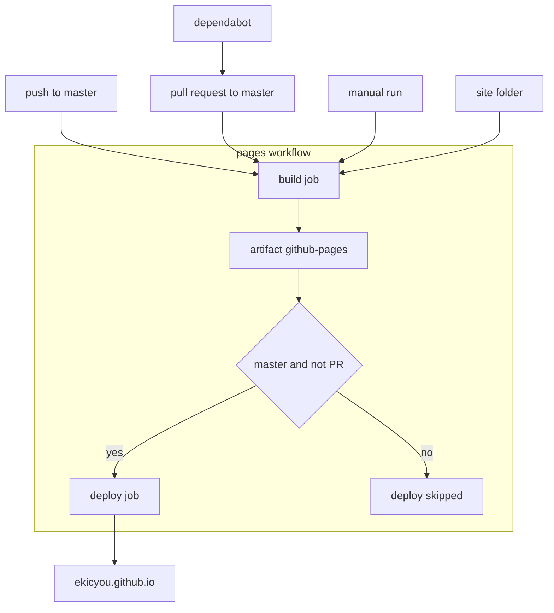
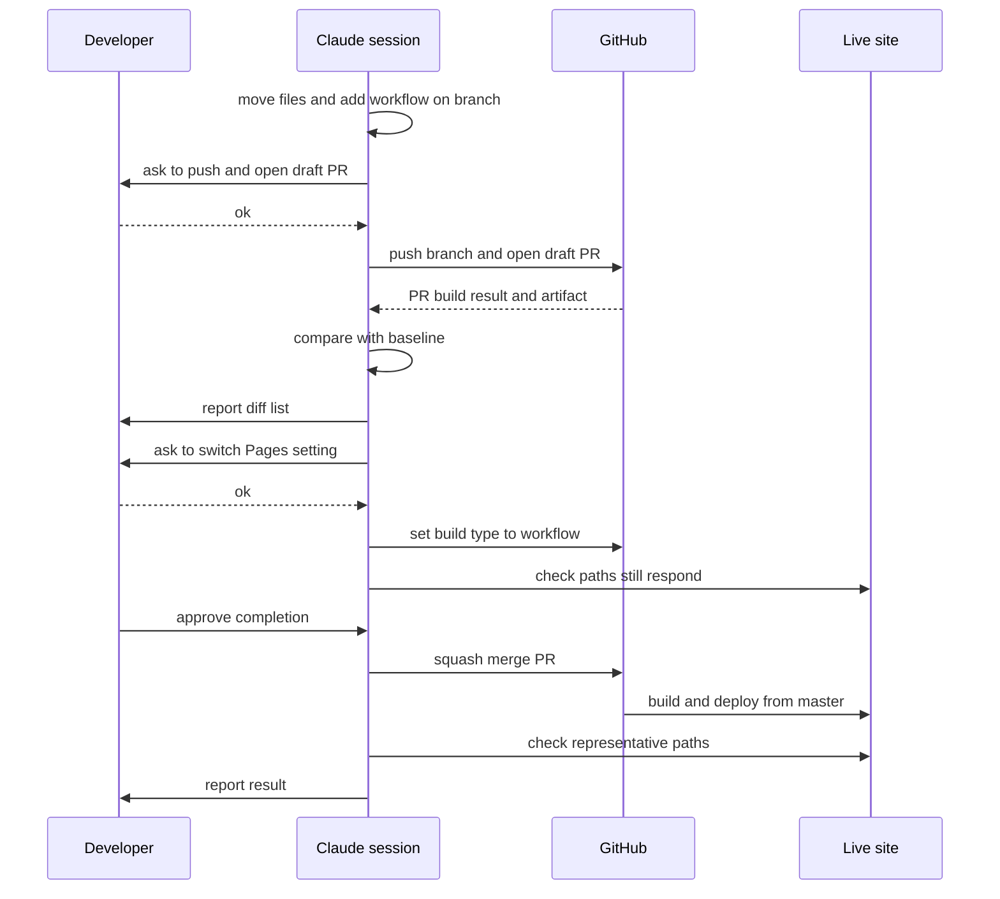
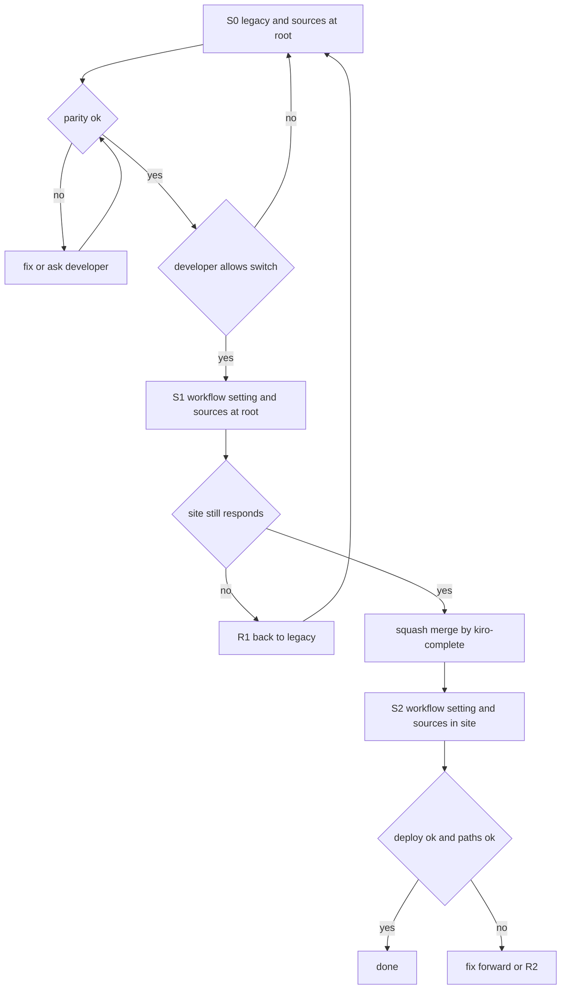

# Design Document: site-subfolder-actions-build

## Overview

**Purpose**: サイト「えちょのざんがい」の原稿を `site/` の下へまとめ、ビルドと公開を GitHub Actions に切り替える。開発者は、ルートに開発用のファイルを置いても公開物への混入を気にせずに済み、PR を出した時点でビルドが通るかどうかが分かる。

**Users**: 開発者(えちょ)と、手伝う Claude のセッション。読者にとっては何も変わらない。

**Impact**: リポジトリの配置(ルート直下 → `site/`)と、GitHub Pages の公開方式の設定(旧来方式 → GitHub Actions)が変わる。公開されるページは、`/README.md` が外れることを除いて変わらない。

### Goals

- 原稿 55 ファイルを、内容を変えずに `site/` へ移す。
- `master` への push でビルドして公開し、PR ではビルドだけを行うワークフローを 1 つ足す。
- 切り替えの前後で公開物が同じであることを、成果物の突き合わせで確かめる。
- 公開方式の設定を、決まった順番と開発者の許しのもとで切り替える。
- 文書(steering、`CLAUDE.md`、`README.md`、完了の手順)を新しい姿に合わせる。

### Non-Goals

- 見た目・レイアウト・スタイルの変更、テーマ指定の食い違いの解消。
- Jekyll の版上げ、Ruby を入れる組み方、生成ツールの乗り換え(`site-astro-redesign`)。
- 手元でビルドする環境づくり、ブランチ保護の導入。
- push のパス絞り込みや、PR ごとの試し公開(プレビュー)。

## Boundary Commitments

### This Spec Owns

- 原稿の置き場が `site/` であるという決まり。
- `.github/workflows/pages.yml`(ビルドと公開の手順、権限、PR と `master` の振り分け)。
- `.github/dependabot.yml`(アクションの版上げの提案)。
- GitHub Pages の公開方式の設定を `workflow` にすること、その段取りと戻し方。
- 切り替えの前後の出力の突き合わせ(1 回きりの確かめ)。
- 上に伴う文書の直し(`tech.md`・`structure.md`・`workflow.md`・`roadmap.md`・`CLAUDE.md`・`README.md`・`kiro-complete` の該当箇所)。

### Out of Boundary

- `site/` の中身そのもの(記事、レイアウト、スタイル、`_config.yml` のテーマ・プラグインの指定)。場所を移すだけで、書き換えない。例外は `site/_config.yml` の `exclude` の 1 行。
- ビルドの中身(Jekyll の版、プラグイン)。公式アクションが決めるものをそのまま使う。
- 記事を書く運用。`master` へ直接 push してよいままである。
- 別リポジトリのページ(`/ghost_dev/`、`/nyan-pu-puu/`、`/zzz-pasta/`、`/old/`)。

### Allowed Dependencies

- GitHub Pages、GitHub Actions(GitHub が動かすランナー)、環境 `github-pages`(今の設定のまま)。
- 公式アクション 4 つ: `actions/checkout`、`actions/jekyll-build-pages`、`actions/upload-pages-artifact`、`actions/deploy-pages`。これ以外のアクションを足さない。
- GitHub CLI(`gh`)。設定の切り替え、成果物の取り出し、実行結果の確かめに使う。
- 手元の Ruby、Docker、Node.js には依存しない。

### Revalidation Triggers

次のどれかを変えたら、`site-astro-redesign` と `workflow.md` の「検証」節を見直す。

- 原稿の置き場(`site/`)の名前や階層。
- ワークフローのファイル名、ジョブ名(`build`・`deploy`)、成果物の名前(`github-pages`)。
- 「PR ではビルドだけ、`master` では公開まで」という振り分けの条件。
- 公開方式の設定(`workflow` 以外に戻す場合)。

## Architecture

### Existing Architecture Analysis

- 今は GitHub が「pages build and deployment」を自動で走らせる。中身は `actions/jekyll-build-pages` v1.0.13(`github-pages` gem 232、Jekyll 3.10.0)で、原稿はリポジトリのルート。
- ルートのファイルは、ドット始まりか `_config.yml` の `exclude` に無い限り公開される。`README.md` はそのまま `/README.md` として出ている。
- 置き場に依存する設定は `_config.yml` の `exclude` にある `CLAUDE.md` の 1 行だけ。テンプレートは置き場を参照していない(`research.md`)。
- `.gitignore`・`.editorconfig`・`.gitattributes` はパスを含まず、直しは要らない。

### Architecture Pattern & Boundary Map



**Architecture Integration**:

- **Selected pattern**: 1 ワークフロー・2 ジョブ。`build` が成果物を作り、`deploy` がそれを公開する。PR では `deploy` を動かさない。
- **Boundaries**: ビルドの手順は `build` ジョブの中だけにある。`deploy` は成果物 `github-pages` しか知らない。次の spec はビルドの段だけを差し替える。
- **Existing patterns preserved**: 「push すれば公開される」。`JEKYLL_ENV=production`、Pages の API から決まる `site.url`、safe モード(どれも公式アクションが今と同じに設定する)。
- **New components rationale**: ワークフロー(旧来方式の代わり)、Dependabot の設定(版を固定する代わりに、古びたら知らせてもらう)。
- **Steering compliance**: URL を変えない。独自ドメインや有料の仕組みを足さない。1 spec = 1 ブランチ = 1 PR。

### Technology Stack

| Layer | Choice / Version | Role in Feature | Notes |
|-------|------------------|-----------------|-------|
| Infrastructure / Runtime | GitHub Actions(`ubuntu-latest`) | ビルドと公開を動かす | 公開リポジトリなので無料 |
| ビルド | `actions/jekyll-build-pages@v1.0.13` | `site/` から `_site/` を作る | 旧来ビルドと同じコンテナ。出力を決めるので細かい版まで指定 |
| 取得 | `actions/checkout@v7` | リポジトリを取り出す | 最新は v7.0.1 |
| 成果物 | `actions/upload-pages-artifact@v5` | `_site/` を `github-pages` として保存 | 保存は既定の 1 日 |
| 公開 | `actions/deploy-pages@v5` | 成果物を GitHub Pages へ公開 | 最新は v5.0.1 |
| 版上げの提案 | Dependabot(`github-actions`) | 上の 4 つの新しい版を PR で提案 | 月 1 回 |
| 操作 | GitHub CLI(`gh`) | 設定の切り替え、確かめ | 既に使っている |

`actions/configure-pages` は使わない(無くても動く)。

## File Structure Plan

### Directory Structure

```
(リポジトリのルート)
├── .github/
│   ├── workflows/
│   │   └── pages.yml          # 新規: ビルドと公開のワークフロー
│   └── dependabot.yml         # 新規: アクションの版上げの提案
├── site/                      # 新規の階層: サイトの原稿(55 ファイル、ここへ移す)
│   ├── _config.yml            # 移動 + exclude から CLAUDE.md を外す
│   ├── Gemfile                # 移動(中身は変えない。ビルドには使われない)
│   ├── index.md  about.md  404.html
│   ├── _posts/  _drafts/
│   ├── _layouts/  _includes/  _sass/  assets/
│   └── doc/  img/
├── .claude/  .kiro/  .vscode/ # そのまま(開発用)
├── .editorconfig  .gitattributes  .gitignore   # そのまま(直し不要を確かめる)
├── CLAUDE.md                  # 直す
└── README.md                  # 直す(site/ へは移さない)
```

`site/` の中の相対配置は、移動の前と同じにする。

### Moved Files

ルートから `site/` へ、`git mv` で移す(中身は変えない)。

- ファイル: `404.html`、`about.md`、`index.md`、`_config.yml`、`Gemfile`
- フォルダ: `_drafts/`、`_includes/`、`_layouts/`、`_posts/`、`_sass/`、`assets/`、`doc/`、`img/`

### Modified Files

- `site/_config.yml` — `exclude` から `CLAUDE.md` を外し、上のコメントを今の事情に合わせる。それ以外は触らない。
- `README.md` — リポジトリの案内に書き直す(原稿は `site/`、push で Actions が公開する)。
- `CLAUDE.md` — 「このリポジトリについて」の節(原稿の置き場、ビルドと公開の方式)。
- `.kiro/steering/tech.md` — Architecture、検証、Common Commands、Key Technical Decisions。戻し方を足す。
- `.kiro/steering/structure.md` — すべての置き場を `site/` 起点に。ルートは開発用だけ、という決まり。
- `.kiro/steering/workflow.md` — 「検証」節と「完了時のアクション」。
- `.kiro/steering/roadmap.md` — この spec の行に済みの印を付ける。
- `.claude/skills/kiro-complete/SKILL.md` — PR が既にあるときの扱い、公開物の範囲の書き方、マージの後の確かめ(4 か所)。

### Deleted Files

- `.travis.yml` — 働いていない遺物。

## System Flows

### 切り替えの段取り



**Key Decisions**:

- 公開方式の設定の切り替えは、`tasks.md` の最後のタスク。マージは `/kiro-complete` が行うので、順番が逆になることは無い(5.1)。
- 開発者に許しを求めるのは 3 回: ブランチの push と下書き PR、設定の切り替え(5.2)、完了の承認=マージ(5.3)。
- 切り替えからマージまでの間は、`master` へ push しても公開されない。最後のタスクと `/kiro-complete` は続けて行う。
- 突き合わせで意図しない差が出たら、切り替えもマージもしない(4.7)。

## Requirements Traceability

| Requirement | Summary | Components | Interfaces | Flows |
|-------------|---------|------------|------------|-------|
| 1.1 | 原稿はすべて `site/` の下 | SiteSource | Moved Files | — |
| 1.2 | ルートは開発用だけ | SiteSource | Directory Structure | — |
| 1.3 | 内容と改行を変えない | SiteSource | 移動だけのコミット、変更行 0 の確かめ | — |
| 1.4 | 履歴を辿れる | SiteSource | `git mv`(名前の変更として記録) | — |
| 1.5 | `site/` の外は公開しない | PagesWorkflow | `source: ./site` | — |
| 1.6 | 相対配置を保つ | SiteSource | Directory Structure | — |
| 2.1 | push でビルドして公開 | PagesWorkflow | `on.push`、`build` → `deploy` | 構成図 |
| 2.2 | 手作業を求めない | PagesWorkflow | 環境 `github-pages` に承認者なし(今のまま) | — |
| 2.3 | ビルド失敗なら公開しない | PagesWorkflow | `deploy.needs: build` | — |
| 2.4 | 失敗が記録される | PagesWorkflow | Actions の実行記録 | — |
| 2.5 | 進行中の公開を打ち切らない | PagesWorkflow | `concurrency`(公開側は `cancel-in-progress: false`) | — |
| 2.6 | 手動で実行できる | PagesWorkflow | `on.workflow_dispatch` | — |
| 2.7 | 手元にビルド環境が要らない | PagesWorkflow | GitHub のランナーで完結 | — |
| 3.1 | PR でビルドして成否を示す | PagesWorkflow | `on.pull_request` | 構成図 |
| 3.2 | PR では公開しない | PagesWorkflow | `deploy.if` | 構成図 |
| 3.3 | PR の失敗を示す | PagesWorkflow | PR のチェック | — |
| 3.4 | `master` の公開を妨げない | PagesWorkflow | `concurrency` の組を PR ごとに分ける | — |
| 3.5 | 成果物を取り出せる | PagesWorkflow | 成果物 `github-pages` | — |
| 4.1 | パスを保つ | ParityCheck、PagesWorkflow | パス一覧の差 | 段取り |
| 4.2 | 中身を保つ | ParityCheck、PagesWorkflow | 中身の差 | 段取り |
| 4.3 | `/README.md` は外れる | SiteSource | `README.md` をルートに残す | — |
| 4.4 | 新たなパスを増やさない | ParityCheck、PagesWorkflow | パス一覧の差、`source: ./site` | — |
| 4.5 | 非公開の記事は非公開のまま | ParityCheck | パス一覧の差 | — |
| 4.6 | マージの前に突き合わせて示す | ParityCheck | 差の一覧の報告 | 段取り |
| 4.7 | 意図しない差ならマージしない | ParityCheck、Cutover | 止める条件 | 段取り |
| 4.8 | 公開後に代表パスを確かめて報告 | Cutover、ProjectDocs | `workflow.md` の「検証」節、`/kiro-complete` | 段取り |
| 5.1 | 切り替えはマージの前 | Cutover | 最後のタスク → `/kiro-complete` | 段取り |
| 5.2 | 切り替えの前に許しを得る | Cutover | 許しの確認 | 段取り |
| 5.3 | マージの前に許しを得る | Cutover | `/kiro-complete` の承認 | 段取り |
| 5.4 | 切り替えの直後に応答を確かめる | Cutover | 代表パスの確認 | 段取り |
| 5.5 | 崩れたら報告し、戻し方を示す | Cutover | 戻し方 | — |
| 5.6 | 戻す手順を前もって文書に | Cutover、ProjectDocs | この文書の Migration Strategy、`tech.md` | — |
| 6.1 | `.travis.yml` を持たない | Cleanup | Deleted Files | — |
| 6.2 | 部品の版を指定 | PagesWorkflow | `uses:` の版 | — |
| 6.3 | 版上げを PR で提案 | DependabotConfig | `github-actions` | — |
| 6.4 | 勝手に取り込まない | DependabotConfig | 自動マージを設定しない | — |
| 7.1 | 文書が新しい姿を記す | ProjectDocs | Modified Files | — |
| 7.2 | マージ前の確かめは PR のビルド | ProjectDocs | `workflow.md` の「検証」節 | — |
| 7.3 | マージ後の確かめ方 | ProjectDocs | `workflow.md` の「検証」節 | — |
| 7.4 | 旧来方式の記述を残さない | ProjectDocs | Modified Files、検索での確かめ | — |
| 7.5 | 戻す手順を記す | ProjectDocs | `tech.md` | — |

## Components and Interfaces

| Component | Domain/Layer | Intent | Req Coverage | Key Dependencies (P0/P1) | Contracts |
|-----------|--------------|--------|--------------|--------------------------|-----------|
| SiteSource | リポジトリの配置 | 原稿を `site/` にまとめる | 1.1, 1.2, 1.3, 1.4, 1.6, 4.3 | git (P0) | State |
| PagesWorkflow | ビルドと公開 | ビルドし、`master` でだけ公開する | 1.5, 2.1〜2.7, 3.1〜3.5, 4.1, 4.2, 4.4, 6.2 | 公式アクション 4 つ (P0)、環境 `github-pages` (P0) | Batch |
| DependabotConfig | 保守 | アクションの版上げを提案する | 6.3, 6.4 | Dependabot (P1) | Batch |
| ParityCheck | 確かめ(1 回きり) | 切り替えの前後の出力を比べる | 4.1, 4.2, 4.4, 4.5, 4.6, 4.7 | PagesWorkflow の成果物 (P0)、旧来の成果物か公開中のサイト (P0) | Batch |
| Cutover | 切り替えの段取り | 設定を切り替え、確かめ、戻せるようにする | 4.7, 4.8, 5.1〜5.6 | GitHub Pages の設定 API (P0)、開発者の許し (P0) | State |
| Cleanup | 片付け | 遺物を消す | 6.1 | — | — |
| ProjectDocs | 文書 | 文書と完了の手順を新しい姿に合わせる | 4.8, 5.6, 7.1〜7.5 | — | — |

### リポジトリの配置

#### SiteSource

| Field | Detail |
|-------|--------|
| Intent | 原稿 55 ファイルを、内容を変えずに `site/` へ移す |
| Requirements | 1.1, 1.2, 1.3, 1.4, 1.6, 4.3 |

**Responsibilities & Constraints**

- 「Moved Files」の一覧を `git mv` で移す。移動だけのコミットを 1 つ作り、内容の直しを混ぜない。
- `site/_config.yml` の `exclude` の直しは、別のコミットにする。
- `README.md`・`CLAUDE.md`・`.claude/`・`.kiro/`・`.vscode/`・ドット始まりの設定ファイルは移さない。
- `.gitignore`・`.editorconfig`・`.gitattributes` は、直しが要らないことを確かめるだけにする。

**Contracts**: State [x]

##### State Management

- **State model**: 移動の後、ルート直下にあるのは開発用のファイルだけ。`site/` の中は移動の前のルートと同じ相対配置。
- **Persistence & consistency**: 移動のコミットは `git diff --cached -M --stat` で、55 件すべてが名前の変更として出て、変更行が 0 であること。
- **Concurrency strategy**: 移動の後に `master` へ記事が足された場合、取り込み(`git merge`)でルートに新しい原稿が現れる。マージの前にルートを見直し、あれば `site/` へ移す。

**Implementation Notes**

- Integration: `core.autocrlf=true` のため、作業ツリーは CRLF、索引は LF。`git mv` は索引の中身を変えないので、差分が全行になることは無いはず。なったら改行が壊れているので、やり直す。
- Validation: `git ls-files` のルート直下が、`.editorconfig`・`.gitattributes`・`.gitignore`・`CLAUDE.md`・`README.md` だけであること。
- Risks: `site/_config.yml` の `exclude` に `Gemfile` が残っているので、`site/Gemfile` は公開されない。この行は消さない。

### ビルドと公開

#### PagesWorkflow

| Field | Detail |
|-------|--------|
| Intent | `site/` からサイトをビルドし、`master` のときだけ公開する |
| Requirements | 1.5, 2.1, 2.2, 2.3, 2.4, 2.5, 2.6, 2.7, 3.1, 3.2, 3.3, 3.4, 3.5, 4.1, 4.2, 4.4, 6.2 |

**Responsibilities & Constraints**

- ファイルは `.github/workflows/pages.yml` の 1 つ。ジョブは `build` と `deploy` の 2 つ。
- ビルドの手順は `build` ジョブにだけ置く。`deploy` ジョブは成果物 `github-pages` を公開するだけにする。
- 権限はジョブごとに明示する。ワークフロー全体の既定は `contents: read` にする(リポジトリの既定が `write` のため)。
- `pull_request_target` は使わない。

**Dependencies**

- Inbound: `master` への push、`master` 向けの PR、手動の実行 (P0)
- External: `actions/checkout@v7`、`actions/jekyll-build-pages@v1.0.13`、`actions/upload-pages-artifact@v5`、`actions/deploy-pages@v5` (P0)
- External: 環境 `github-pages`(公開を許すブランチは `master` だけ。今の設定を変えない) (P0)

**Contracts**: Batch [x]

##### Batch / Job Contract

| 項目 | `build` ジョブ | `deploy` ジョブ |
|---|---|---|
| Trigger | `push`(`master`)、`pull_request`(`master` 向け)、`workflow_dispatch` | `build` の成功の後。`pull_request` 以外、かつ `refs/heads/master` のときだけ |
| 権限 | `contents: read`、`pages: read` | `pages: write`、`id-token: write` |
| 環境 | なし | `github-pages`(`url` に公開先を出す) |
| 手順 | 取得 → Jekyll のビルド(`source: ./site`、`destination: ./_site`) → 成果物の保存(`path: ./_site`) | `actions/deploy-pages` |
| 出力 | 成果物 `github-pages` | 公開されたサイト |

- **`pages: read` の理由**: ビルド中に Pages の API を読んで `site.url` を決める。読めないと、フィードや SNS 向けの情報の絶対 URL が変わる恐れがある(4.2)。
- **同時実行**:

  | 実行の種類 | `concurrency.group` | `cancel-in-progress` |
  |---|---|---|
  | `pull_request` | PR ごとに別の組(PR 番号を含む) | `true`(古い実行は捨ててよい) |
  | PR 以外で `master`(公開まで進む) | 公開用の 1 つの組 | `false`(進行中の公開を打ち切らない) |
  | PR 以外で `master` 以外(手動の実行。公開しない) | ブランチごとに別の組 | `true`(古い実行は捨ててよい) |

  公開用の組では、待っている実行は最新の 1 つだけが残る。最後に push された内容が最後に公開される(2.5)。PR の実行は別の組なので、公開を待たせも取り消しもしない(3.4)。`master` 以外での手動の実行も公開用の組に入れない。入れると、待っている公開を押しのけてしまう(実装中に見つけて、組を 3 つに分けた)。
- **Idempotency & recovery**: 同じコミットを何度公開しても結果は同じ。失敗したら、Actions の画面か `gh run rerun` でやり直せる。ビルドが失敗すれば `deploy` は動かず、前の公開物が残る(2.3)。

**Implementation Notes**

- Integration: `site-astro-redesign` は `build` ジョブの「Jekyll のビルド」の段を差し替える。成果物の名前と `deploy` ジョブには触れない。
- Validation: 下書き PR で `build` が成功し、`deploy` が「skipped」になること。マージの後、`master` の実行で両方が成功すること。
- Risks: Dependabot が開く PR では、トークンが読み取り専用になる。`build` は読み取りの権限だけで動くので、支障は無い見込み(最初の提案 PR で確かめる)。

#### DependabotConfig

| Field | Detail |
|-------|--------|
| Intent | ワークフローが使うアクションの新しい版を、PR で提案させる |
| Requirements | 6.3, 6.4 |

**Contracts**: Batch [x]

##### Batch / Job Contract

- Trigger: 月 1 回(`schedule.interval: monthly`)。
- Input / validation: `package-ecosystem: github-actions`、`directory: /`。
- Output / destination: `master` 向けの PR。PagesWorkflow がその PR をビルドする。
- 自動マージは設定しない。取り込むかどうかは開発者が決める(6.4)。

**Implementation Notes**

- Integration: `site-astro-redesign` が、ここに npm の項目を足す。
- Risks: `jekyll-build-pages` の版上げの提案が来たら、出力が変わり得る。次の spec が済むまでは見送ってよい。

### 確かめと切り替え

#### ParityCheck

| Field | Detail |
|-------|--------|
| Intent | 切り替え前の公開物と、新しいビルドの成果物を比べ、差の一覧を出す |
| Requirements | 4.1, 4.2, 4.4, 4.5, 4.6, 4.7 |

**Responsibilities & Constraints**

- 1 回きりの確かめ。道具や取り出したファイルはセッションの scratchpad に置き、リポジトリには何も残さない。
- 比べるのは、パスの一覧と、各ファイルの中身の両方。
- 結果は「一致」「意図した差」「既知の揺れ」「意図しない差」に分けて、開発者に示す。

**Contracts**: Batch [x]

##### Batch / Job Contract

- **Trigger**: 下書き PR の `build` が成功した後。公開方式の設定を切り替える前。
- **Input**:
  - 新: 下書き PR の実行の成果物 `github-pages`(`gh run download`)。
  - 基準(優先): `master` の最新の「pages build and deployment」の成果物 `github-pages`。保存は 1 日。実行 `38144045597` の分は 2026-10-12T13:39Z に失効する。
  - 基準(代わり): 失効していたら、公開中のサイト。新しい成果物の全パスを 1 つずつ取得して比べる。加えて、追跡ファイルの一覧から「旧来だけで公開されていたはずのパス」(`/README.md` など)を挙げ、応答を確かめる。
- **Output**: 差の一覧(パスの増減、中身の違うファイルと違いの箇所)。

  | 区分 | 見込み | 扱い |
  |---|---|---|
  | 意図した差 | `README.md` が無くなる | 通す(4.3) |
  | 既知の揺れ | `feed.xml` の更新時刻 | 通す(4.2 の但し書き) |
  | 意図しない差 | 上の 2 つ以外のすべて | 止める(4.7) |

- **Idempotency & recovery**: 何度やり直してもよい。意図しない差が出たら、原因を直して PR のビルドからやり直すか、開発者の判断を仰ぐ。

**Implementation Notes**

- Integration: 基準を取った後に `master` が進んでいたら、基準を取り直す。
- Validation: 非公開の記事 3 本(`published: false`)が、どちらの一覧にも無いこと(4.5)。`site/` で始まるパス、`CLAUDE.md`、`Gemfile` が新しい一覧に無いこと(4.4)。
- Risks: 旧来ビルドを作り直す手(`POST …/pages/builds`)は、公開中のサイトへの再公開になる。使うなら開発者の許しを得る。

#### Cutover

| Field | Detail |
|-------|--------|
| Intent | 公開方式の設定を切り替え、前後を確かめ、戻せるようにする |
| Requirements | 4.7, 4.8, 5.1, 5.2, 5.3, 5.4, 5.5, 5.6 |

**Responsibilities & Constraints**

- 切り替えは、ParityCheck が通った後、開発者の明示の許しを得てから行う。
- 切り替えは `tasks.md` の最後のタスク。その後に残るのは `/kiro-complete`(マージと、マージの後の確かめ)だけにする。
- マージの後の確かめ(4.8)は `/kiro-complete` が、`workflow.md` の「検証」節に従って行う。`tasks.md` には入れない(マージの前に済みにできないため)。

**Contracts**: State [x]

##### State Management

| 状態 | 公開方式の設定 | `master` の中身 | 公開されるもの | 戻し方 |
|---|---|---|---|---|
| S0 切り替え前 | `legacy` | 原稿はルート | 旧来ビルドの出力 | — |
| S1 切り替え後・マージ前 | `workflow` | 原稿はルート、ワークフロー無し | S0 の公開物が残る(2026-10-12 の切り替えの直後に、54 ファイルのバイト一致で確かめた) | R1 |
| S2 マージ後 | `workflow` | 原稿は `site/`、ワークフローあり | Actions の出力 | R2 |

- **S0 → S1**: `gh api -X PUT repos/ekicyou/ekicyou.github.io/pages -f build_type=workflow`。API が通らなければ、開発者に画面(Settings → Pages → Source → GitHub Actions)での操作を頼む。直後に、設定が `workflow` になったことと、代表パスが応答することを確かめる(5.4)。
- **S1 → S2**: `/kiro-complete` の squash マージ。`master` への push で PagesWorkflow が動き、最初の公開が行われる。
- **禁じる遷移**: 設定が `legacy` のままのマージ。全ページが `/site/...` の下に公開される。

**代表パス**(5.4 と 4.8 で使う):

| 応答するはず(200) | 応答しないはず(404) |
|---|---|
| `/`、`/about.html`、`/feed.xml`、`/assets/main.css`、`/2026/03/26/emo2.html`、`/doc/cosmogenesis/entanglement_cosmogenesis_v1_ja.html`、`/img/alto0044_400x400.png` | `/site/`、`/CLAUDE.md`、`/Gemfile`。S2 では `/README.md` も |

`/404.html` は 200 で応答する。存在しないパスは、この 404 ページの中身と 404 の状態で応答する。

**Implementation Notes**

- Integration: S1 の間は `master` へ push しても公開されない。切り替えの前に開発者へ伝え、切り替えと `/kiro-complete` を続けて行う。
- Validation: 切り替えの後は `gh api repos/ekicyou/ekicyou.github.io/pages --jq .build_type` が `workflow` を返す。マージの後は `gh run list --workflow pages.yml --branch master --limit 1` の結果が成功であること。
- Risks: 戻し方は下の「Migration Strategy」。崩れを見つけたら、その場で開発者に報告し、戻し方を示す(5.5)。戻す操作そのものも公開中のサイトに効くので、開発者の許しを得てから行う。

### 片付けと文書

#### Cleanup

`.travis.yml` を消す(6.1)。ほかに消すものは無い。`.gitignore` の Ruby 向けの行は、Jekyll の原稿が残っている間は置いておく。

#### ProjectDocs

| Field | Detail |
|-------|--------|
| Intent | 文書と完了の手順を、新しい配置と方式に合わせる |
| Requirements | 4.8, 5.6, 7.1, 7.2, 7.3, 7.4, 7.5 |

**直す内容**

| ファイル | 直すこと |
|---|---|
| `.kiro/steering/tech.md` | Architecture(Actions がビルドして公開、原稿は `site/`)。検証(PR のビルドで確かめる)。Common Commands(`gh run list --workflow pages.yml` など。`pages/builds/latest` は消す)。Key Technical Decisions(`.travis.yml` の行を消し、公式アクションを使う理由と、戻し方 R1・R2 を足す) |
| `.kiro/steering/structure.md` | すべての置き場を `site/` 起点に書き直す。「ルートに置くのは開発用だけ。`site/` の外は公開されない」。`.github/` を開発用に足す。`exclude` で外す、という記述を消す |
| `.kiro/steering/workflow.md` | 「検証」節: マージの前は「PR の上の `build` が成功していること」(`gh pr checks`)。マージの後は「`master` の実行が成功し、公開されたこと」(`gh run list` / `gh run watch`)。配置・設定・ビルド方式に触れた変更では、代表パスも確かめて報告する(代表パスの一覧は、上の「Cutover」からこの節へ直接写す)。末尾の「切り替えたら書き換える」の一文を消す。「完了時のアクション」の 6 も合わせる |
| `.kiro/steering/roadmap.md` | この spec の行を済みにする |
| `CLAUDE.md` | 「このリポジトリについて」: 原稿は `site/`、`master` への push で Actions がビルドして公開、PR ではビルドだけ |
| `README.md` | リポジトリの案内(サイトの URL、原稿は `site/`、公開の仕組み)に書き直す |
| `.claude/skills/kiro-complete/SKILL.md` | (a) ステップ 7: そのブランチの PR が既にあれば作らずに使う(下書きなら `gh pr ready`、題名と本文は `gh pr edit` で差し替える)。(b) ステップ 6-5: 「公開物の外」の判定を「`site/**` と `.github/**` を含まないこと」に。(c) 冒頭の棚卸しの「依存(`Gemfile`)」を「ビルドに使うアクションの版」に。(d) マージの後に、`workflow.md` の「検証」節が定める確かめを行って報告する手順と、チェックリストの行を足す |

**Implementation Notes**

- Integration: `kiro-complete` は areka から写した独自のスキル(`workflow.md` の「cc-sdd の版上げ」に載っている)。直した点はスキルの中に残るので、一覧への追記は要らない。
- Validation: 直した後に、`旧来`・`legacy`・`pages/builds`・`exclude`・`ルートが` などで steering と `CLAUDE.md` を検索し、旧来方式を前提にした記述が残っていないこと(7.4)。`roadmap.md` の「旧来ビルドと同じコンテナ」のような経緯の説明は残してよい。
- Risks: `workflow.md` の「検証」節は `/kiro-complete` が読む正本。書いたコマンドは、下書き PR の実行で実際に試してから載せる(7.3)。

## Error Handling

### Error Strategy

止めるべき所で止め、公開中のサイトを崩さない。自動の仕組みは `needs` と条件で守り、手作業の段は「許しを得る → 行う → 直後に確かめる」の順にする。

### Error Categories and Responses

| 起きること | 見つけ方 | 応じ方 |
|---|---|---|
| PR のビルドが失敗 | PR のチェックが赤 | 原因を直して push。マージしない |
| `master` のビルドが失敗 | `master` の実行が失敗 | 公開は行われず、前の公開物が残る。直す PR を出す |
| 公開(`deploy`)が失敗 | `deploy` ジョブが失敗 | 前の公開物が残る。`gh run rerun` でやり直す。続くなら報告 |
| 突き合わせで意図しない差 | 差の一覧 | 切り替えもマージもしない。直すか、開発者の判断を仰ぐ |
| 設定の切り替えが API で通らない | `gh api` の終了コード | 開発者に画面での操作を頼む |
| 切り替えの直後にサイトが応答しない | 代表パスの確認 | 開発者に報告し、R1 を示す |
| マージの後に公開物が崩れた | 代表パスの確認 | 開発者に報告。直す PR(前へ直す)か R2 を示す |

### Monitoring

GitHub の既定の通知(失敗した実行のメール)に任せる。仕組みは足さない。

## Testing Strategy

手元ではビルドできない。確かめは、PR の上の実行、成果物、公開中のサイトで行う。

### 配置の確かめ(コミットの前後)

- 移動のコミットが、55 件すべて名前の変更で、変更行が 0 であること(1.3、1.4)。
- ルート直下の追跡ファイルが開発用の 5 つだけであること(1.2)。`site/` の中の相対配置が移動の前と同じであること(1.6)。
- `site/_config.yml` の差分が `exclude` の周りだけであること(1.3 の例外)。

### ワークフローの確かめ(下書き PR)

- 下書き PR で `build` が成功し、PR のチェックに出ること(3.1)。
- 同じ実行で `deploy` が「skipped」であること(3.2)。
- 実行の成果物 `github-pages` を取り出せること(3.5)。
- ワークフローの定義で、`deploy` が `build` に依存し(2.3)、公開側の `cancel-in-progress` が `false`(2.5)、PR 側の組が別であること(3.4)。失敗させる実地の試しは行わず、定義の読み合わせで確かめる。

### 出力の確かめ(ParityCheck)

- パスの一覧の差が `README.md` の 1 件だけであること(4.1、4.3、4.4)。
- 中身の差が `feed.xml` の更新時刻だけであること(4.2)。コメント欄の部品が記事ページに出ていること、フィードと SNS 向けの絶対 URL が `https://ekicyou.github.io` で始まること。
- 非公開の記事 3 本が一覧に無いこと(4.5)。

### 切り替えの確かめ

- 切り替えの直後: 設定が `workflow` であること。代表パスが今までどおり応答すること(5.4)。
- マージの後(`/kiro-complete`): `master` の実行で `build` と `deploy` が成功すること(2.1)。代表パスが応答し、`/site/` と `/README.md` が 404 であること(4.8)。

### 文書の確かめ

- steering と `CLAUDE.md` に、旧来方式を前提にした記述が残っていないこと(7.4)。
- `workflow.md` の「検証」節のコマンドを、下書き PR と `master` の実行で実際に使えること(7.2、7.3)。

## Security Considerations

- 権限は最小にする。`build` は読み取りだけ(`contents: read`、`pages: read`)。書き込み(`pages: write`、`id-token: write`)は `deploy` だけ。
- `pull_request_target` を使わない。外からの PR のコードが、書き込みの権限を持つ実行で動くことは無い。
- 公開は環境 `github-pages` を通る。この環境は `master` しか受け付けない(今の設定のまま)。
- 使うアクションは GitHub の公式(`actions/*`)だけにする。
- origin の URL にはユーザー名が含まれる。コマンドの出力を報告へ写すときは伏せる。

## Migration Strategy



**戻し方**(どちらも公開中のサイトに効く。開発者の許しを得てから行う)

- **R1(S1 → S0)**: 設定を旧来方式へ戻し、ビルドを求める。`master` の原稿はまだルートにあるので、これだけで元に戻る。

  ```bash
  gh api -X PUT repos/ekicyou/ekicyou.github.io/pages -f build_type=legacy -f "source[branch]=master" -f "source[path]=/"
  gh api -X POST repos/ekicyou/ekicyou.github.io/pages/builds
  ```

  この 2 つのコマンドは試していない(未確認)。通らなければ、画面(Settings → Pages → Source → Deploy from a branch、`master` の `/`)で戻す。
- **R2(S2 から)**: まず「前へ直す」(原因を直す PR)を考える。公開に失敗している間は前の公開物が残るので、急いで戻す必要は薄い。どうしても S0 へ戻すなら、squash のコミットを打ち消す PR をマージし(原稿がルートへ戻り、ワークフローも消える)、その後で R1 を行う。順番を逆にすると、旧来ビルドが `/site/...` の下に公開してしまう。

**検証の区切り**: ParityCheck(切り替えの前)、代表パス(切り替えの直後)、`master` の実行と代表パス(マージの後)。
