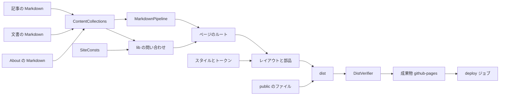
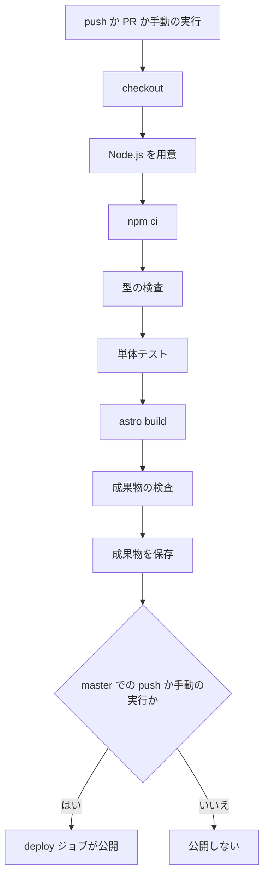
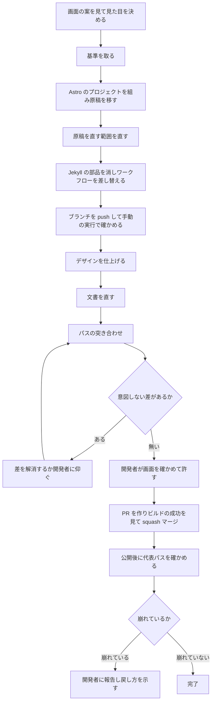

# Design Document: site-astro-redesign

## Overview

**Purpose**: サイト「えちょのざんがい」の生成ツールを Jekyll から Astro へ乗り換え、レイアウトとスタイルを一から作る。開発者は、手元で画面を見ながらデザインを直せるようになり、見た目を決めているファイルがリポジトリを見れば分かるようになる。

**Users**: 開発者(えちょ)と、手伝う Claude のセッション。読者は、同じ URL で、新しいデザインのページを読む。

**Impact**: `site/` の中身が、Jekyll の原稿から Astro のプロジェクトに替わる。ページの中身(HTML)は作り直しになる。公開済みの 28 個のパスと、記事・文書の本文は変わらない。ワークフローは、ビルドの段だけが替わる。

この文書は、見た目に左右されない作り(置き場、ルート、部品、仕組み)を決める。配色・背景・書体などの具体の見た目は、開発者が画面の案を見てから決める(3.12、3.13)。決め方は「画面の案」の節にまとめた。見た目は、設計ディスカッション(2026-10-12)で決まった。この文書の中で「画面の案で決める」と書いた箇所の答えは、どれも「画面の案」の節の「決まった見た目」の表にある。

### Goals

- 公開済みの 28 個のパスを保ち、その保ち方をビルドのたびに検査する。
- 記事 15 本・文書 2 本・About の原稿を、front matter を書き換えずに引き継ぐ。
- レイアウト・部品・スタイルを自前のファイルとして持ち、明るい配色と暗い配色の両方で表示する。
- コメント欄、数式、コードの色付けとコピー、SNS 向けの情報、フィードを作り直す。
- 手元(Windows、Node.js、npm)で画面を見ながら直せるようにする。
- ビルドに使う部品の版を固定し、版上げを PR で受け取る。
- Jekyll の部品を消し、プロジェクト文書を新しい姿に合わせる。

### Non-Goals

- 記事の内容の書き換え(「原稿を直す範囲」の 4 種類を除く)。記事や文書の URL の変更。
- タグごとの一覧ページ、サイトマップ、サイト内検索、配色の手動の切り替え、ページ遷移の演出。
- 公開方式(GitHub Pages + Actions)と `site/` という置き場の変更。独自ドメイン。
- アイコン絵の原画探し。新しい絵の用意。
- 別リポジトリのページ(`/ghost_dev/`、`/nyan-pu-puu/`、`/zzz-pasta/`、`/old/`)。
- 構造化データ(JSON-LD)。今は `jekyll-seo-tag` が出しているが、要件に無いので出さない。

## Boundary Commitments

### This Spec Owns

- `site/` の中身のすべて(Astro のプロジェクト、原稿の置き場、レイアウト・部品・スタイル、そのまま置くファイル)。
- 記事の URL の決まり(ファイル名 `YYYY-MM-DD-<名前>.md` → `/YYYY/MM/DD/<名前>.html`)と、front matter の定義。
- `.github/workflows/pages.yml` の `build` ジョブの手順と権限。
- `.github/dependabot.yml` の npm の項目。
- ビルドの成果物の検査(保つパスの一覧、公開してはいけないパス)。
- 原稿の移動と、「原稿を直す範囲」の直し。
- 切り替えの前後の突き合わせと、公開後の確かめ(1 回きり)。
- プロジェクト文書の直し(`tech.md`・`structure.md`・`product.md`・`workflow.md`・`roadmap.md`・`CLAUDE.md`・`README.md`)と、ルートの `.gitignore`。

### Out of Boundary

- `pages.yml` の `deploy` ジョブ、起動の条件、`concurrency`、成果物の名前(`github-pages`)。1 本目が決めたものを変えない。
- GitHub Pages の公開方式の設定(`workflow` のまま)。環境 `github-pages` の設定。
- giscus の側の設定(リポジトリ、カテゴリ)。今の値をそのまま使う。
- 記事を書く運用(`master` へ直接 push してよい)。
- 別リポジトリのページ。
- Dependabot のセキュリティ更新など、リポジトリの設定画面で決まるもの。

### Allowed Dependencies

- **npm のパッケージ**: 「Technology Stack」に挙げたものだけ。UI の枠組み(React など)、CSS の枠組み(Tailwind など)、Sass、MDX、サイトマップの統合、既製テーマは足さない。
- **閲覧者のブラウザが読みに行く外部**: giscus(今と同じ)、Google Fonts(書体。7.5 が認めている)。これ以外を足さない。KaTeX のスタイルシートとフォントは、外部からではなく、自分の公開物から配る。
- **公式アクション**: `actions/checkout`、`actions/setup-node`、`actions/upload-pages-artifact`、`actions/deploy-pages`。`actions/jekyll-build-pages` は外す。サードパーティのアクション(`withastro/action` を含む)は使わない。
- **手元の道具**: Windows、Node.js、npm、git、GitHub CLI(`gh`)。Ruby と Docker には依存しない。
- **依存の向き**: `consts` → `lib` → `components` → `layouts` → `pages`。右のものだけが左のものを読み込む。`styles` を読み込むのは `layouts` だけ。`lib` は部品を読み込まない。

### Revalidation Triggers

次のどれかを変えたら、この設計と `workflow.md` の「検証」節を見直す。

- 記事の URL の決まり、原稿の置き場、front matter の定義。
- Markdown の処理系(従来の処理系 → Sätteri)、数式の描画の方式。
- Astro の主版、Node.js の主版。
- `pages.yml` のジョブ名、成果物の名前、PR と `master` の振り分け。
- giscus の「ページとの対応の取り方」(`pathname`)。
- 成果物の検査が認めるパスの形(新しいトップ階層を足すとき)。
- 閲覧者のブラウザが読みに行く外部を足すとき。

## Architecture

### Existing Architecture Analysis

- **残すもの**: `site/` という置き場。`pages.yml` の 2 ジョブの形、起動の条件、`concurrency`、`deploy` ジョブ、成果物の名前。`.gitattributes` の LF の固定。記事のファイル名の決まりと front matter。
- **替えるもの**: `build` ジョブの中身(Jekyll の公式アクション → Node.js の用意、`npm ci`、検査、ビルド)。成果物の場所(`./_site` → `site/dist`)。
- **消すもの**: Jekyll の部品 24 個(`_layouts/`・`_includes/`・`_sass/`・`assets/`・`_config.yml`・`Gemfile`)、`index.md`、`404.html`、`_drafts/`。
- **片付く負債**: テーマの指定と実態の食い違い。止まった配布元から読んでいる MathJax。使われていない favicon。メールアドレスの表示。
- **試作で確かめた出発点**(`research.md` の §2、§11): ファイル単位の出力、ファイル名をそのまま識別子にする指定、ファイル名から作る URL、従来の処理系と数式・囲み・日本語の太字のプラグイン、`public/`、`@astrojs/rss`、giscus の埋め込み。この設計の置き場とルートの形でも、28 個のパスが出ることを確かめた。

### Architecture Pattern & Boundary Map

静的サイトの生成。原稿(Markdown)をコンテンツ機能で読み、ページのルートがレイアウトに流し込み、`dist/` に HTML を出す。サーバー側の処理は無い。閲覧側のスクリプトは、コードのコピーと giscus の 2 つだけである。



**Architecture Integration**:

- **選んだ形**: Astro のコンテンツ機能(コレクション)+ 動的ルート。原稿に `layout: post` があるため、Markdown を `src/pages/` に直に置く形は使えない(試作で確かめた)。
- **責任の分け方**: URL を決めるのは `lib/post-path.ts` と各ルートだけ。見た目を決めるのは `styles/` と部品だけ。原稿は見た目を知らない。
- **保つ形**: 1 ファイル・2 ジョブのワークフロー、公式アクションだけの組み方、版の固定と Dependabot の提案。
- **新しく足す部品の理由**: 成果物の検査(`DistVerifier`)は、プロダクトの最優先(公開済みの URL を壊さない)を、人の注意ではなく仕組みで守るために足す。
- **steering との整合**: 「凝った機能より壊れにくさ」に合わせ、閲覧側のスクリプトと依存を最小にする。

### 設計で決めた点

`requirements.md` の「設計で決める点」への答え。調べの詳しい記録は `research.md` の §11 にある。

| 点 | 決めたこと | 理由 |
|---|---|---|
| Markdown の処理系 | 従来の処理系(`@astrojs/markdown-remark` の `unified()`)を明示して選ぶ | 数式・囲み・日本語の太字のプラグインがそろい、試作で動いた。Astro 7 の既定(Sätteri)では、数式の描画・囲み・太字が自作になる。Astro の文書は従来の処理系を公式の選択肢として扱っており、廃止の予告は無い。原稿は「どちらの処理系でも同じに読める形」に直すので(2.12)、後で移る手間は小さい |
| 数式の描画 | KaTeX をビルド時に動かす(`rehype-katex`)。スタイルシートとフォントは `katex` パッケージから束ねて自分の公開物として配り、数式のあるページだけに入れる。フォントは `woff2` だけを出す | MathJax(SVG)よりページが軽く(v7 で約 330 KB と 825 KB)、数式の文字を選べる。外部の配布元に頼らないので、今の MathJax のように配布元が止まって困ることが無い。数式のために増えるパスは 20 個(スタイルシート 1、フォント 19)に収まる |
| 数式のあるページの見分け方 | 出力の HTML に数式があるかで決める。front matter の `use_math` は受け入れるが、使わない | `use_math` を書き忘れても崩れない。要件は「数式を含む記事と文書」(4.4)であり、目印の有無ではない |
| 原稿の置き場 | 記事 `site/src/content/posts/`、文書 `site/src/content/doc/<題材>/`、About `site/src/content/pages/about.md`、そのまま置くファイル `site/public/img/`・`site/public/doc/<題材>/` | Astro の決まり(`src/` に原稿、`public/` に加工しないファイル)に合わせる。文書の置き場の名前を `doc` にするのは、公開パス(`/doc/`)と `public/doc/` に揃え、置き間違いを減らすため |
| ビルドの段 | 自前で並べる(Node.js の用意 → `npm ci` → 型の検査 → 単体テスト → ビルド → 成果物の検査 → 保存) | 版を厳密に固定でき、公式アクションだけで組める。`withastro/action` は `npm install` を使い、サードパーティのアクションが 1 つ増える |
| 手元の表示でのコメント欄 | 出す(公開と同じ) | 暗い配色でのコメント欄の見え方(3.15)を、手元で確かめる必要がある。見るだけなら何も書き込まれない。手元から投稿すると本番のページのコメントになるので、手順に「手元から投稿しない」と書く |
| 名前が `index` の記事 | 仕組みで防ぎ、書き方の決まりにも書く | `lib/post-path.ts` が、ファイル名を挙げてビルドを止める。Astro の既定のエラーは原因が読み取りにくい |
| 利用状況の送信 | 止める | 送る理由が無い。ワークフローでは環境変数 `ASTRO_TELEMETRY_DISABLED` を置く。手元では、最初の 1 回だけ `npx astro telemetry disable` を実行する(PC ごとの設定)。手順に書く |
| `lang` の値 | `ja` | 地域を区別する必要が無く、言語だけの指定が標準の書き方である。giscus の `data-lang` も `ja`。`og:locale` は `ja_JP` のまま |
| 画像の飾りから外す決まり | 既定は「本文の画像はすべて飾る」。外すのは、SVG、原稿が HTML で `align` か `style` を指定した画像、`class="plain"` を付けた画像、スタイルシートの「飾らない画像」の一覧に挙げた画像 | 透過かどうかは CSS では分からず、ビルド時に調べる手も、別リポジトリの画像には届かない。仕組みで決まる分と、個別に挙げる分に分ける。個別の一覧は、画面の案を見て開発者が決める(下の「画面の案」) |
| Node.js の版 | `site/.node-version` に、主版だけを書く(`26`)。ワークフローはこのファイルを読み、その主版の一番新しい版を用意する。主版を上げるかどうかは、Astro の主版の版上げを取り込むときに、あわせて見直す(開発者の決め、2026-10-12) | 開発者の言葉: 「年に数回しか更新しないサイトなので、そのくらい緩くてよい」。Node.js の版上げは Dependabot が提案できないので、細かい版まで固定すると、誰も上げないまま古びる。主版だけなら、細かい版と安全上の直しは、何もしなくても入る。出力を決めるのは Astro と依存の版であり、こちらは細かい版まで固定する。Astro が求めるのは 22.12 以上。手元の Node.js は 26.8.1 で、同じ主版である |
| Linux での `npm ci` | 切り替えの PR を出す前に、ブランチを push して手動の実行で確かめる | 手動の実行はビルドだけで、公開しない(1 本目の作り)。ロックファイルは Windows で作るので、早めに確かめる |
| Dependabot の npm | 置き場 `/site`、月 1 回。小さい版上げ(minor・patch)は 1 つの PR にまとめ、主版の版上げは 1 つずつ | 提案の数を抑えつつ、壊れやすい主版は 1 つずつ確かめる |
| コードの配色 | Shiki に配色を 2 つ渡し(`themes` に `light` と `dark`)、色を CSS の変数として出させる。どちらを使うかはスタイルシートが決める | 明暗の両方に対応する、Astro の文書どおりの方法。試作で動いた。配色の名前は画面の案で決める |
| 囲みの見出しの言葉 | プラグインの出力(「NOTE」「IMPORTANT」)をそのまま使う。言葉を変える設定は無い。変えたいときはスタイルシートで置き換える | プラグインを自作に替えるほどの理由が無い。見え方は画面の案で決める |
| 突き合わせの基準 | `master` の実行の成果物(`github-pages`)から取ったパスの一覧を、spec フォルダの `baseline-paths.txt` に置き、基準にする。マージの直前に、`master` の先頭が、一覧を取ったコミットと同じかを確かめる | 原稿から割り出した一覧より確かである(1 本目の手順)。成果物は 1 日で消えるので、取れるうちに取って置いておく |
| `build` ジョブの権限 | `contents: read` だけにする。`pages: read` を外す | `pages: read` は Jekyll が Pages の API を読むための権限だった |
| 型の検査 | 入れる(`astro check`) | 版上げの PR で、ビルドでは見つからない型の食い違いを見つける。版を固定しているので、記事を足すだけの push では結果が変わらない |
| front matter の定義に無い項目 | ビルドを止める | `published` の打ち間違いで、非公開の記事が公開されるのを防ぐ。今の 18 本は、この定義で通る(確かめ済み) |
| 本文のメールアドレス | 文書 `entanglement_cosmogenesis_v1_ja.md` の「連絡：」の行にあるメールアドレスは、原稿を直さず、今と同じく文字のまま出す。自動でリンク(`mailto:`)になるのを、`astro.config.mjs` の中の小さな部品(`rehypeNoMailto`)で止める(開発者の決め、2026-10-12) | 新しい処理系は、地の文のアドレスを自動でリンクにする。リンクは文字より拾われやすく、フッターからアドレスを外した狙い(3.25)と逆を向く。連絡先を載せたのは原稿の意図なので、本文は書き換えない(2.2)。そのまま置く TeX と PDF にも同じアドレスがあるが、中身を変えない決まり(1.3)により据え置く(今も公開中のもの)。確かめ済み: 部品を入れると、どのページにも `mailto:` が出ず、アドレスは文字として残る |
| favicon の置き場 | `/favicon.ico` は置かない。各ページの `<link rel="icon">` で指す。新しい絵柄を作るときは `/_astro/` の下に出す | 保つべきパスを増やさない。今の `/img/favicon.ico`・`/img/favicon.png` は公開し続ける |

**Node.js の版上げの扱い**: Node.js の版上げは、Dependabot が提案できない(版を書いたファイルに対応していない)。初めの要件(7.3)は実行環境の版上げも PR で提案させるとしていたが、設計ディスカッションで要件を直した(7.1〜7.3)。Node.js は主版だけを固定し、主版の版上げは提案を求めず、手順で見直す。Astro の版上げの PR が新しい Node.js を求めたときは、その PR のビルドが失敗して気付ける。`tech.md` に、見直す手順(Astro の主版を上げるときに、Node.js の主版も確かめる)を書く。生成ツールとその依存の版上げは、Dependabot が提案する。

### Technology Stack

| Layer | Choice / Version | Role in Feature | Notes |
|-------|------------------|-----------------|-------|
| 生成ツール | `astro` 7.3.8 | 静的サイトの生成、手元の表示 | 出力は `build.format: 'file'`、`trailingSlash: 'never'`、`site: 'https://ekicyou.github.io'`。`base` は置かない |
| Markdown | `@astrojs/markdown-remark` 7.3.2 | 従来の処理系(`unified()`) | GFM と見出しの id は、付いてくる既定のまま |
| 数式 | `remark-math` 6.0.0、`rehype-katex` 7.0.1、`katex` 0.16.47 | `$…$` と `$$…$$` を読み、ビルド時に描く | `katex` は、スタイルシートを読み込むために直に入れる。`rehype-katex` が使う版と揃える |
| 囲み | `remark-github-blockquote-alert` 2.1.0 | `[!NOTE]`・`[!IMPORTANT]` を囲みにする | 構造だけを使い、付属のスタイルシートは使わない |
| 日本語の太字 | `remark-cjk-friendly` 2.3.2 | 約物に接した太字を太字として読む | |
| コードの色付け | Shiki(`astro` に付いてくる) | ビルド時に色を付ける | 配色を 2 つ渡す |
| フィード | `@astrojs/rss` 4.0.19 | `/feed.xml`(RSS 2.0) | |
| 型の検査 | `@astrojs/check` 0.9.10、`typescript` 6.0.3 | `astro check` | 開発用の依存 |
| 単体テスト | Node.js の標準(`node --test`) | `lib` の関数の確かめ | 依存を足さない |
| スタイル | 素の CSS(CSS の変数、`prefers-color-scheme`) | デザインのトークン、本文のスタイル | |
| 書体 | Google Fonts(`<link>` で読む) | 本文の書体 | 具体の書体は画面の案で決める。読めないときは OS のゴシック体になる |
| コメント欄 | giscus(今と同じ設定) | 記事と文書のコメント欄 | |
| 実行環境 | Node.js 26(主版だけを固定)、npm(Node.js に付いてくるもの) | ビルドと手元の表示 | `site/.node-version`。確かめに使った版は 26.8.1 |
| CI | `actions/checkout@v7`、`actions/setup-node@v7`、`actions/upload-pages-artifact@v5`、`actions/deploy-pages@v5` | ビルドと公開 | ランナーは `ubuntu-latest` |

`package.json` には、版を範囲ではなく、そのままの数字で書く。版は、試作と設計の確かめで動かしたものである。

## File Structure Plan

### Directory Structure

```
site/
├── package.json                 # 依存と npm のスクリプト(dev・build・preview・check・test・verify)
├── package-lock.json            # 版の固定(管理下に置く)
├── .node-version                # Node.js の主版(26)
├── astro.config.mjs             # サイトの設定、Markdown の処理系とプラグイン、Shiki の配色
├── tsconfig.json                # astro/tsconfigs/strict を継ぐ。tests・scripts・dist は検査から外す
├── public/                      # そのまま置くファイル(中身を変えずに公開される)
│   ├── img/                     # 今の site/img/ の 7 個
│   └── doc/cosmogenesis/        # 今の site/doc/cosmogenesis/ の PDF・TeX・JPEG
├── src/
│   ├── content.config.ts        # コレクション 3 つの定義と front matter の検査
│   ├── consts.ts                # サイト名、説明文、作者、リンク、giscus の設定、既定の画像、メニュー
│   ├── content/
│   │   ├── posts/               # 記事。YYYY-MM-DD-<名前>.md を平らに置く(15 本)
│   │   ├── doc/cosmogenesis/    # 文書の Markdown(2 本)
│   │   └── pages/about.md       # About の本文
│   ├── lib/
│   │   ├── post-path.ts         # ファイル名 → 日付・名前・公開パス(検査つき。astro に依らない)
│   │   ├── posts.ts             # 公開中の記事の一覧、前後の記事
│   │   ├── docs.ts              # 公開中の文書の一覧と公開パス
│   │   └── summary.ts           # 説明の決め方、数式の有無(astro に依らない)
│   ├── layouts/
│   │   ├── BaseLayout.astro     # <html>、<head>、ヘッダー、フッター
│   │   └── ArticleLayout.astro  # 題名、日付、タグ、目次、本文、前後の記事、コメント欄
│   ├── components/
│   │   ├── HeadMeta.astro       # 題名、説明、正規の URL、SNS 向けの情報、フィード、favicon、書体、KaTeX のスタイルシート
│   │   ├── SiteHeader.astro     # サイト名とメニュー
│   │   ├── SiteFooter.astro     # サイト名、作者、GitHub、Mastodon、フィード、説明文
│   │   ├── Hero.astro           # トップページの顔(アイコン絵と説明文)
│   │   ├── PostList.astro       # 記事の一覧
│   │   ├── DocList.astro        # 文書の欄
│   │   ├── Toc.astro            # 目次
│   │   ├── TagList.astro        # タグの表示
│   │   ├── PostNav.astro        # 前後の記事へのリンク
│   │   ├── Comments.astro       # giscus
│   │   └── CodeCopy.astro       # コードのコピーのボタン(閲覧側のスクリプト)
│   ├── pages/
│   │   ├── index.astro                          # /
│   │   ├── about.astro                          # /about.html
│   │   ├── 404.astro                            # /404.html
│   │   ├── feed.xml.ts                          # /feed.xml
│   │   ├── [year]/[month]/[day]/[name].astro    # /YYYY/MM/DD/<名前>.html
│   │   └── doc/[...id].astro                    # /doc/<題材>/<名前>.html
│   └── styles/
│       ├── tokens.css           # デザインのトークン(明るい配色と暗い配色)
│       ├── base.css             # 土台(文字、リンク、ページの骨組み)
│       └── prose.css            # 本文(見出し、表、コード、画像、囲み、数式)
├── scripts/
│   └── verify-dist.mjs          # 成果物の検査、パスの一覧、基準との突き合わせ
└── tests/
    ├── kept-paths.txt           # 保つパスの一覧(28 行)
    ├── post-path.test.ts        # post-path.ts の単体テスト
    └── summary.test.ts          # summary.ts の単体テスト
```

新しい絵柄の favicon を作ると決まったときだけ、`site/src/assets/` に置く(画面の案で決める)。

`site/` の外に新しく作るファイルは、spec フォルダの中だけである: `.kiro/specs/site-astro-redesign/migration-report.md`(移行の記録。直した箇所、数式の確かめ、パスの突き合わせ、公開後の確かめの結果)。設計の時点で、`baseline-paths.txt`(突き合わせの基準)と `look/`(決まった見た目の実物)を置いてある。

**部品の名前とファイルの対応**(下の節で使う名前のうち、ファイル名と違うもの):

| 名前 | ファイル |
|---|---|
| AstroConfig、MarkdownPipeline(その中の Markdown の設定) | `site/astro.config.mjs` |
| PackageManifest | `site/package.json`・`site/package-lock.json`・`site/.node-version` |
| ContentCollections | `site/src/content.config.ts` |
| PostPath、ContentQueries、Summary、SiteConsts | `site/src/lib/post-path.ts`、`site/src/lib/posts.ts` と `docs.ts`、`site/src/lib/summary.ts`、`site/src/consts.ts` |
| HomePage、PostPage、DocPage、AboutPage、NotFoundPage、FeedEndpoint | `site/src/pages/` の `index.astro`、`[year]/[month]/[day]/[name].astro`、`doc/[...id].astro`、`about.astro`、`404.astro`、`feed.xml.ts` |
| PagesWorkflow、DependabotConfig | `.github/workflows/pages.yml`、`.github/dependabot.yml` |
| DistVerifier | `site/scripts/verify-dist.mjs`・`site/tests/kept-paths.txt` |
| ManuscriptMigration | 下の「移すファイル」と、「原稿を直す範囲」の直し |
| CutoverVerification | `.kiro/specs/site-astro-redesign/migration-report.md` |
| ProjectDocs | 下の「Modified Files」の steering・`CLAUDE.md`・`README.md` |
| ScreenProposals | 案そのものはリポジトリの外(「画面の案」の節)。決まった値は「決まった見た目」の表、決まった案の実物は `.kiro/specs/site-astro-redesign/look/` |

### 移すファイル(中身を変えず、`git mv` で移す)

| 今の場所 | 新しい場所 | 数 |
|---|---|---|
| `site/_posts/*.md` | `site/src/content/posts/` | 13 |
| `site/_posts/note/*.md` | `site/src/content/posts/`(サブフォルダをやめる) | 2 |
| `site/doc/cosmogenesis/*.md` | `site/src/content/doc/cosmogenesis/` | 2 |
| `site/about.md` | `site/src/content/pages/about.md` | 1 |
| `site/img/*` | `site/public/img/` | 7 |
| `site/doc/cosmogenesis/` の PDF・TeX・JPEG | `site/public/doc/cosmogenesis/` | 3 |

### 消すファイル

- `site/_layouts/`(4)、`site/_includes/`(12)、`site/_sass/`(4)、`site/assets/`(2)、`site/_config.yml`、`site/Gemfile`
- `site/index.md`、`site/404.html`(`src/pages/` に作り直す)
- `site/_drafts/dummy.md`(下書きの置き場をやめる)

### Modified Files

- `.github/workflows/pages.yml` — `build` ジョブの手順と権限を差し替える。先頭の説明も直す。ほかは変えない。
- `.github/dependabot.yml` — npm の項目を足す。
- `.gitignore` — Jekyll 用の中身を、`node_modules`・`dist`・`.astro` に替える。
- `site/src/content/doc/cosmogenesis/*.md`、`site/src/content/posts/2026-02-06-pasta.md` — 「原稿を直す範囲」の直し(移した後で、別のコミットにする)。
- `.kiro/steering/` の `tech.md`(ほぼ全体)・`structure.md`(配置と書き方の決まり)・`product.md`(数式と下書きの記述)・`workflow.md`(「検証」節)・`roadmap.md`(完了の印)、`CLAUDE.md`、`README.md` — 書く中身は「Migration Strategy」の「プロジェクト文書に書くこと」にある。

## System Flows

### ビルドと公開



- どの段が失敗しても、成果物は保存されず、`deploy` は動かない。前の公開物が残る(6.3)。
- 型の検査・単体テスト・成果物の検査は、版を固定した依存と、リポジトリの中身だけで結果が決まる。記事を足すだけの push で落ちるのは、記事のファイル名か front matter が決まりに合わないときと、成果物の検査が誤りと定めたもの(保つパスが消えた、など)が出たときだけである。

## Requirements Traceability

| Requirement | Summary | Components | Interfaces / 仕組み |
|---|---|---|---|
| 1.1 | 28 個のパスを保つ | AstroConfig、ページのルート、FeedEndpoint、`public/`、DistVerifier | `build.format: 'file'`、`tests/kept-paths.txt` |
| 1.2 | 名前の綴りを保つ | ContentCollections、PostPath | `generateId`(ファイル名のまま) |
| 1.3 | そのまま置くファイルの中身を変えない | `public/` | 加工されない置き場 |
| 1.4, 1.5, 1.7 | 別リポジトリと同じトップ階層・開発用のファイル・サイトマップを出さない | ページのルート、PagesWorkflow、DistVerifier | 保存するのは `site/dist` だけ。認めるパスの形 |
| 1.6 | 新しいパスを要る部品に限る | AstroConfig、DistVerifier | `/_astro/` だけ。KaTeX のフォントは `woff2` だけ |
| 1.8 | 新しいデザインの 404 | NotFoundPage、BaseLayout | `src/pages/404.astro` |
| 2.1 | 記事・文書・単独のページをすべて表示 | ページのルート | ルートの表 |
| 2.2, 2.8, 2.12, 2.16 | 本文を書き換えず、改行を変えず、直しを 4 種類に限り、移動として移す | ManuscriptMigration | `git mv`。移動と直しを別のコミットにする |
| 2.3, 2.4 | 今の front matter を受け入れ、読めない・`title` が無いときはビルドを止める | ContentCollections | front matter の定義 |
| 2.5, 2.6 | 既存の要素と囲みを読める形で表示 | MarkdownPipeline、`prose.css` | `remark-github-blockquote-alert` |
| 2.7 | サイト内リンクと画像が届くことを確かめる | DistVerifier | リンクの検査(警告) |
| 2.9, 2.10 | 記事を足せば公開・一覧・フィードに載る。日付はファイル名から | PostPath、ContentQueries、HomePage、FeedEndpoint | `parsePostId()`、`publishedPosts()` |
| 2.11 | `published: false` を出さない | ContentQueries | `publishedPosts()`・`publishedDocs()` |
| 2.13 | 約物に接した太字と `\lambdabar` を仕組みで受け止める | MarkdownPipeline | `remark-cjk-friendly`、KaTeX の `macros` |
| 2.14 | 直した箇所の一覧を示す | ManuscriptMigration | 移行の記録 |
| 2.15 | ほかの崩れは開発者に仰ぐ | ManuscriptMigration、CutoverVerification | 見つけたら直す前に止まる |
| 2.17 | 記事を平らに置く | PostPath、File Structure Plan | サブフォルダはビルドを止める |
| 3.1, 3.2 | 自前のファイルによる 1 つのデザイン | BaseLayout、`layouts/`・`components/`・`styles/` | すべてのページが BaseLayout を継ぐ |
| 3.3 | トップから全記事・全文書・About へ | HomePage、PostList、DocList、SiteHeader | |
| 3.4 | 今ある画像だけを使う | Hero、HeadMeta、SiteConsts | `/img/alto0044_400x400.png` |
| 3.5 | 日本語のページと示す | BaseLayout | `<html lang="ja">` |
| 3.6, 3.7 | 遊び心を主眼に、読みやすさも保つ | `tokens.css`、`prose.css`、Hero、ScreenProposals | 画面の案で決める |
| 3.8 | 幅に合わせて本文を広げる | `base.css`、ArticleLayout | 本文の幅を固定しない |
| 3.9 | 背景を白一色にしない | `tokens.css` | `--color-bg`、`--bg-image` |
| 3.10 | 本文の画像に飾り | `prose.css` | 画像の飾りの決まり |
| 3.11 | ゴシック体の系統の書体 | `tokens.css`、HeadMeta | `--font-body`、Google Fonts |
| 3.12, 3.13 | 画面の案を 2 つ以上作り、見てから決める | ScreenProposals | 「画面の案」の表 |
| 3.14 | 明暗の両方、環境の設定に合わせる | `tokens.css` | `prefers-color-scheme` |
| 3.15 | コード・数式・囲み・表・コメント欄も明暗を揃える | AstroConfig、`prose.css`、Comments | Shiki の配色 2 つ、giscus の `preferred_color_scheme` |
| 3.16, 3.17 | トップに顔、全記事の一覧、文書の欄 | Hero、PostList、DocList | |
| 3.18 | 目次 | Toc、ArticleLayout | `headings` |
| 3.19 | 前後の記事 | PostNav、ContentQueries | `adjacentPosts()` |
| 3.20, 3.21 | タグを表示し、タグごとの一覧ページは作らない | TagList、ページのルート | リンクにしない。ルートを置かない |
| 3.22, 3.23 | 狭い画面で本文を横に送らず、幅を食う要素だけ横に送る | `base.css`、`prose.css` | 表・コード・数式・`<iframe>`・画像 |
| 3.24 | メニューと目次が邪魔にならない | SiteHeader、Toc | 折り返すメニュー、畳める目次 |
| 3.25 | フッターの中身、メールアドレスを出さない | SiteFooter、SiteConsts、DistVerifier | `mailto:` の検査 |
| 3.26 | favicon | HeadMeta | `<link rel="icon">` |
| 3.27 | About に日付を出さない | AboutPage | 日付を渡さない |
| 4.1, 4.3 | 今と同じコメント欄、コメントとの対応を保つ | Comments | giscus の設定、`data-mapping="pathname"` |
| 4.2 | `comments: false` で出さない | ArticleLayout | |
| 4.4 | 文中と独立の数式 | MarkdownPipeline、HeadMeta | `remark-math`、`rehype-katex` |
| 4.5 | 数式を 1 本ずつ確かめる | CutoverVerification | 移行の記録 |
| 4.6, 4.7 | コードの色付け。知らない言語は色付けなし | AstroConfig | Shiki |
| 4.8, 4.9, 4.11 | SNS 向けの情報、フィードの場所 | HeadMeta、Summary | 絶対 URL、`<link rel="alternate">` |
| 4.10 | フィード | FeedEndpoint | RSS 2.0 |
| 4.12, 4.13 | コピーのボタン | CodeCopy | |
| 4.14 | 説明の既定 | Summary | `describe()` |
| 4.15 | 画像の既定はアイコン絵 | HeadMeta、SiteConsts | 小さい画像のカード |
| 5.1 | 手順どおりに手元の表示を始められる | PackageManifest、ProjectDocs | `npm run dev` |
| 5.2, 5.3 | 書き換えがすぐ映る。Windows・Node.js・npm だけで動く | PackageManifest | Astro の開発サーバー |
| 5.4 | 公開と同じパスで見える | ページのルート | 確かめ済み |
| 6.1, 6.2, 6.3, 6.5 | push で公開、PR ではビルドだけ、失敗したら公開しない、手作業なし | PagesWorkflow | 1 本目の振り分けを保つ |
| 6.4 | ほかの振る舞いを変えない | PagesWorkflow | `build` の手順と権限のほかは触れない |
| 7.1, 7.2 | 版を固定し、固定した版だけでビルド | PackageManifest、PagesWorkflow | `package-lock.json`、`.node-version`、`npm ci` |
| 7.3, 7.4 | 版上げを PR で提案し、勝手に取り込まない | DependabotConfig | npm の項目。Node.js は手順で補う |
| 7.5 | 外部のサービスを増やさない | Allowed Dependencies | giscus と Google Fonts だけ |
| 8.1, 8.5 | Jekyll の部品と下書きの置き場を持たない | File Structure Plan | 消すファイル |
| 8.2 | 使われているファイルだけ | File Structure Plan、ScreenProposals | 案の切り替えの仕組みを入れない |
| 8.3, 8.4 | `site/` の下の、流儀どおりの置き場 | File Structure Plan | `src/content/`、`public/` |
| 9.1, 9.2 | パスの突き合わせ。意図しない差があればマージしない | CutoverVerification、DistVerifier | `--baseline` |
| 9.3 | 開発者の明示の許し | CutoverVerification | |
| 9.4, 9.5 | 公開後の代表のパス。崩れていたら報告と戻し方 | CutoverVerification、ProjectDocs | |
| 9.6, 9.7 | 試作で確かめ、結果を話し合いへ | (済み) | `research.md` の §2、`requirements.md` |
| 9.8 | 試作はリポジトリの外 | (済み)、ScreenProposals | 画面の案も同じ扱い |
| 10.1, 10.2, 10.5 | 新しい姿と書き方の決まりを記し、Jekyll の記述を残さない | ProjectDocs | |
| 10.3, 10.4 | 手元で確かめる方法と、新しい代表のパス | ProjectDocs | `workflow.md` の「検証」節 |
| 10.6 | 戻す手順を記す | ProjectDocs | `tech.md` の「戻し方」 |

## Components and Interfaces

| Component | Layer | Intent | Req Coverage | Key Dependencies | Contracts |
|---|---|---|---|---|---|
| AstroConfig | 設定 | 出力の形、Markdown の処理、コードの配色を決める | 1.1, 1.6, 1.7, 2.5, 2.6, 2.13, 3.15, 4.4, 4.6, 4.7 | astro(P0)、プラグイン 4 つ(P0) | State |
| PackageManifest | 設定 | 依存と版、npm のスクリプト | 5.1, 5.3, 7.1 | npm(P0) | Batch |
| ContentCollections | 中身 | 原稿を読み、front matter を検査する | 1.2, 2.3, 2.4 | astro の glob ローダー(P0) | Service |
| PostPath | 中身 | ファイル名から日付・名前・公開パスを作る | 1.2, 2.9, 2.10, 2.17 | なし | Service |
| ContentQueries | 中身 | 公開中の記事と文書の一覧、前後の記事 | 2.9, 2.11, 3.19 | ContentCollections(P0)、PostPath(P0) | Service |
| Summary | 中身 | 説明の決め方、数式の有無 | 4.9, 4.14 | なし | Service |
| SiteConsts | 中身 | サイトに 1 つだけの値を持つ | 3.4, 3.25, 4.15 | なし | State |
| PostPage / DocPage / AboutPage / HomePage / NotFoundPage | ルート | パスごとにページを出す | 1.1, 1.4, 1.8, 2.1, 3.3, 3.21, 3.27, 5.4 | ContentQueries(P0)、レイアウト(P0) | API |
| FeedEndpoint | ルート | `/feed.xml` を出す | 2.9, 4.10 | `@astrojs/rss`(P0)、ContentQueries(P0)、Summary(P1) | API |
| BaseLayout | UI | すべてのページの枠 | 1.8, 3.1, 3.5 | HeadMeta、SiteHeader、SiteFooter(P0) | — |
| ArticleLayout | UI | 記事・文書・About の枠 | 3.8, 3.18, 4.2 | BaseLayout、Toc、TagList、PostNav、Comments、CodeCopy | — |
| HeadMeta | UI | `<head>` の中身 | 3.4, 3.11, 3.26, 4.4, 4.8, 4.9, 4.11, 4.15 | SiteConsts(P0)、Google Fonts(P1) | — |
| SiteHeader / SiteFooter | UI | サイト名、メニュー、フッター | 3.3, 3.24, 3.25 | SiteConsts(P0) | — |
| Hero / PostList / DocList | UI | トップページの顔、一覧、文書の欄 | 3.3, 3.6, 3.16, 3.17 | ContentQueries、Summary | — |
| Toc / TagList / PostNav | UI | 目次、タグ、前後の記事 | 3.18, 3.19, 3.20, 3.24 | — | — |
| Comments | UI | giscus の埋め込み | 3.15, 4.1, 4.3 | giscus(P1) | — |
| CodeCopy | UI | コードのコピーのボタン | 4.12, 4.13 | ブラウザのクリップボード(P1) | State |
| スタイル(`tokens.css`・`base.css`・`prose.css`) | UI | トークンと本文の見た目 | 2.5, 2.6, 3.6〜3.11, 3.14, 3.15, 3.22, 3.23 | — | — |
| PagesWorkflow | CI | ビルドして成果物を保存する | 1.5, 6.1, 6.2, 6.3, 6.4, 6.5, 7.2 | 公式アクション 4 つ(P0) | Batch |
| DependabotConfig | CI | 版上げを PR で提案する | 7.3, 7.4 | Dependabot(P1) | Batch |
| DistVerifier | 検査 | 成果物の検査と突き合わせ | 1.1, 1.4, 1.5, 1.6, 1.7, 2.7, 3.25, 9.1 | Node.js(P0) | Batch |
| ScreenProposals | 作業 | 画面の案を作り、見た目を決める | 3.12, 3.13, 8.2, 9.8 | 開発者の判断(P0) | — |
| ManuscriptMigration | 作業 | 原稿の移動と直し | 2.2, 2.8, 2.12, 2.14, 2.15, 2.16 | git(P0) | — |
| CutoverVerification | 作業 | 切り替えの前後の確かめ | 2.15, 4.5, 9.1, 9.2, 9.3, 9.4, 9.5 | `gh`(P0)、開発者の判断(P0) | — |
| ProjectDocs | 作業 | steering と案内の文書の直し | 5.1, 9.5, 10.1, 10.2, 10.3, 10.4, 10.5, 10.6 | — | — |

### 設定

#### AstroConfig

| Field | Detail |
|-------|--------|
| Intent | 出力の形、Markdown の処理系とプラグイン、コードの配色を 1 か所で決める |
| Requirements | 1.1, 1.6, 1.7, 2.5, 2.6, 2.13, 3.15, 4.4, 4.6, 4.7 |

**Responsibilities & Constraints**

- `site: 'https://ekicyou.github.io'`、`build.format: 'file'`、`trailingSlash: 'never'`。`base` は置かない。出力先は既定の `dist`、束ねた部品の置き場は既定の `_astro`。
- 統合(integrations)は入れない。サイトマップも入れない(1.7)。
- ページ遷移の演出(`ClientRouter`)は使わない。giscus のスクリプトが、遷移の後で動かなくなるためである。

**Dependencies**

- External: `astro`、`@astrojs/markdown-remark`、`remark-math`、`rehype-katex`、`remark-github-blockquote-alert`、`remark-cjk-friendly`(どれも P0)

**Contracts**: State [x]

##### State Management(MarkdownPipeline の設定)

| 設定 | 値 | 効き目 |
|---|---|---|
| `markdown.processor` | `unified({ remarkPlugins, rehypePlugins })` | 従来の処理系を使う。プラグインはここへ渡す(`markdown.remarkPlugins` は廃止予定) |
| `remarkPlugins`(順番どおり) | `remark-cjk-friendly`、`remark-math`、`remarkAlert` | 約物に接した太字(2.13)、数式の読み取り(4.4)、囲み(2.6) |
| `rehypePlugins` | `rehypeNoMailto`(このファイルの中に書く、十数行の部品)、`rehype-katex`(`strict: false`、`macros` に `\lambdabar` の定義) | `href` が `mailto:` で始まるリンクを、中の文字に戻す(3.25)。数式をビルド時に描く。`\lambdabar` を記号として出す(2.13) |
| `markdown.shikiConfig` | `themes: { light, dark }`、`defaultColor: false` | 色を `--shiki-light`・`--shiki-dark` などの CSS の変数として出す。配色の名前は画面の案で決める |
| `vite.plugins` | KaTeX のスタイルシートから `woff` と `ttf` の指定を落とす、小さな変換 | 公開物に出るフォントを `woff2` だけにする(1.6) |

**Implementation Notes**

- Integration: GFM(表、URL の自動リンク、脚注)と見出しの id は、処理系の既定のまま使う。見出しの id は、今のサイトと 270 個のうち 269 個が同じになる(数式を含む見出しの 1 個だけが違う)。
- Validation: 知らない言語名(`pasta`)は、ビルドの記録に警告が出て、色付けなしになる。ビルドは止まらない(4.7)。警告は消さない。
- Risks: `\lambdabar` の字形の出来は、数式の確かめ(4.5)で画面を見て決める。KaTeX のスタイルシートの書き方が変わって変換が効かなくなっても、`woff` と `ttf` が余分に出るだけで、表示は崩れない。

#### PackageManifest

| Field | Detail |
|-------|--------|
| Intent | 依存の版を固定し、作業の入口を npm のスクリプトに揃える |
| Requirements | 5.1, 5.3, 7.1 |

**Contracts**: Batch [x]

##### Batch / Job Contract

| スクリプト | 中身 | 使いどころ |
|---|---|---|
| `npm run dev` | `astro dev` | 手元の表示(`http://localhost:4321/`) |
| `npm run build` | `astro build` | `dist/` に出す |
| `npm run preview` | `astro preview` | ビルドした結果を手元で見る |
| `npm run check` | `astro check` | 型の検査 |
| `npm test` | `node --test tests/` | 単体テスト |
| `npm run verify` | `node scripts/verify-dist.mjs` | 成果物の検査 |

- どれも `site/` の中で実行する。
- 版は、`package.json` にそのままの数字で書き、`package-lock.json` を管理下に置く。Node.js は、主版だけを `site/.node-version` に書く。

### 中身

#### ContentCollections

| Field | Detail |
|-------|--------|
| Intent | 原稿を 3 つのコレクションとして読み、front matter を検査する |
| Requirements | 1.2, 2.3, 2.4 |

**Responsibilities & Constraints**

- コレクションは `posts`(`src/content/posts`、`**/*.md`)、`doc`(`src/content/doc`、`**/*.md`)、`pages`(`src/content/pages`、`*.md`)の 3 つ。
- 識別子は、ファイル名から拡張子を除いたもの(`generateId`)。既定の小文字化と記号落としを使わない(1.2)。
- 3 つとも同じ front matter の定義を使う(下の「Data Models」)。定義に無い項目があれば、ビルドを止める。

**Contracts**: Service [x]

##### Service Interface

原稿の型は、`astro:content` が定義から作る `CollectionEntry<'posts'>`・`CollectionEntry<'doc'>`・`CollectionEntry<'pages'>` である(下では `PostEntry`・`DocEntry` と書く)。

- Preconditions: 原稿が UTF-8 の Markdown で、先頭に YAML の front matter がある。
- Postconditions: 検査を通った原稿だけが読める。通らないときは、ビルドが終了コード 1 で止まり、コレクション名・識別子・項目名・ファイルの場所を示す(2.4)。
- Invariants: `layout` はただのデータで、レイアウトの選択には使わない。

#### PostPath

| Field | Detail |
|-------|--------|
| Intent | 記事の識別子(ファイル名)から、日付・名前・公開パスを作る |
| Requirements | 1.2, 2.9, 2.10, 2.17 |

**Responsibilities & Constraints**

- 記事の URL を決める、ただ 1 つの場所である。ルート・一覧・フィード・前後の記事は、ここが返す `path` を使う。
- `astro` の機能に依らない(単体テストで直に呼べる)。

**Contracts**: Service [x]

##### Service Interface

```typescript
interface PostPath {
  year: string;      // "2026"
  month: string;     // "03"
  day: string;       // "26"
  name: string;      // "emo2"(綴りはファイル名のまま)
  date: Date;        // その日の日本時間の 0 時
  dateText: string;  // "2026-03-26"
  path: string;      // "/2026/03/26/emo2.html"
}

function parsePostId(id: string): PostPath; // 決まりに合わないときは Error を投げる
```

- Preconditions: `id` は、`posts` コレクションの識別子(拡張子を除いたファイル名)。
- Postconditions: `path` は `/YYYY/MM/DD/<名前>.html`。`<名前>` は、大文字・小文字・記号を変えない。
- 投げる Error(どれも識別子を文に含める。ビルドが止まる):
  - 識別子に `/` がある(サブフォルダに置いた)。
  - `YYYY-MM-DD-<名前>` の形でない。
  - 日付として読めない。
  - `<名前>` が `index` である。
- Invariants: front matter の `date` は見ない(2.10)。

#### ContentQueries(`lib/posts.ts`・`lib/docs.ts`)

| Field | Detail |
|-------|--------|
| Intent | 公開中の記事と文書を、決まった順に返す |
| Requirements | 2.9, 2.11, 3.19 |

**Contracts**: Service [x]

##### Service Interface

```typescript
interface Post extends PostPath {
  entry: PostEntry;
}
interface Doc {
  entry: DocEntry;
  path: string; // "/doc/<題材>/<名前>.html"
}
interface Adjacent {
  older?: Post;
  newer?: Post;
}

function publishedPosts(): Promise<Post[]>;  // 新しい順
function adjacentPosts(posts: readonly Post[], current: Post): Adjacent;
function publishedDocs(): Promise<Doc[]>;    // 公開パスの昇順
```

- Preconditions: なし。
- Postconditions: `published: false` の原稿は含まない(2.11)。`publishedPosts()` は、非公開の記事も含めたすべての識別子を `parsePostId()` に通す。決まりに合わないファイルは、非公開でもビルドを止める。
- Invariants: 記事の順は、日付の新しい順。同じ日付のときは、名前の降順(毎回同じ順になる)。ページ・一覧・フィード・前後の記事は、どれもこの関数の結果だけを使う。

#### Summary(`lib/summary.ts`)

| Field | Detail |
|-------|--------|
| Intent | ページの説明を決める。出力に数式があるかを見分ける |
| Requirements | 4.9, 4.14 |

**Contracts**: Service [x]

##### Service Interface

```typescript
interface DescribeInput {
  description?: string; // front matter の値
  html?: string;        // 描いた後の本文(entry.rendered?.html)
}

function describe(input: DescribeInput, fallback: string): string;
function firstParagraphText(html: string): string | undefined;
function hasMath(html: string | undefined): boolean;
```

- Postconditions:
  - `describe()` は、`description`(空でなければ)→ 本文の最初の段落の文字 → `fallback`(サイトの説明文)の順に選ぶ(4.14)。
  - `firstParagraphText()` は、本文の最初の `<p>` からタグを除き、文字参照を戻し、空白をまとめた文字を返す。文字が無ければ(画像だけの段落など)`undefined` を返す。200 字を超えるときは、200 字で切って「…」を付ける。
  - `hasMath()` は、本文の HTML に KaTeX の出力があるかを返す。各ルートは、この結果を `math` としてレイアウトへ渡す。
- Invariants: `astro` の機能に依らない。説明の決まりは、SNS 向けの情報・記事の一覧・フィードの 3 か所で、同じ `describe()` を使う。

#### SiteConsts(`src/consts.ts`)

| Field | Detail |
|-------|--------|
| Intent | サイトに 1 つだけの値を、1 か所に持つ |
| Requirements | 3.4, 3.25, 4.15 |

**Contracts**: State [x]

##### State Management

```typescript
interface NavItem {
  label: string;
  href: string;
}
interface SiteConfig {
  url: string;           // "https://ekicyou.github.io"
  title: string;         // "えちょのざんがい"
  description: string;   // 今の site/_config.yml の説明文と同じ文
  author: string;        // "ekicyou"
  lang: 'ja';
  ogLocale: 'ja_JP';
  icon: string;          // "/img/alto0044_400x400.png"(顔と、既定の SNS 向けの画像)
  favicon: string;       // 画面の案で決める
  feedPath: '/feed.xml';
  fontsHref?: string;    // Google Fonts のスタイルシートの URL。画面の案で決める
  nav: readonly NavItem[];
  links: { github: string; mastodon: string };
  giscus: Readonly<Record<string, string>>; // giscus のスクリプトに渡す data-* の値
}
```

- giscus の値は、今の `site/_includes/giscus_comments.html` と同じ 12 項目にする(`research.md` の §2.3 の i の表)。要になるのは、リポジトリ `ekicyou/ekicyou.github.io`(`MDEwOlJlcG9zaXRvcnk2OTMzMzcz`)、カテゴリ `Announcements`(`DIC_kwDOAGnLfc4CzVb5`)、対応の取り方 `pathname`、配色 `preferred_color_scheme` である。
- メールアドレスの項目は持たない(3.25)。`site/_config.yml` を消すことで、サイトの設定からメールアドレスが消える。文書 1 本の本文と、そのまま置く TeX・PDF には残る(「設計で決めた点」の「本文のメールアドレス」)。

### ルート

#### ページのルート

| Field | Detail |
|-------|--------|
| Intent | 公開パスごとに、原稿をレイアウトへ流し込む |
| Requirements | 1.1, 1.4, 1.8, 2.1, 3.3, 3.21, 3.27, 5.4 |

**Contracts**: API [x]

##### API Contract

| ルートのファイル | 出るパス | 元 | レイアウト | 備考 |
|---|---|---|---|---|
| `pages/index.astro` | `/`(`/index.html`) | `publishedPosts()`、`publishedDocs()` | BaseLayout | Hero、PostList、DocList |
| `pages/[year]/[month]/[day]/[name].astro` | `/YYYY/MM/DD/<名前>.html` | `publishedPosts()` | ArticleLayout | 日付、タグ、目次、前後の記事、コメント欄 |
| `pages/doc/[...id].astro` | `/doc/<題材>/<名前>.html` | `publishedDocs()` | ArticleLayout | タグ、目次、コメント欄。日付と前後の記事は無い |
| `pages/about.astro` | `/about.html` | `pages` の `about` | ArticleLayout | 日付を出さない(3.27)。目次と前後の記事は無い |
| `pages/404.astro` | `/404.html` | — | BaseLayout | 新しいデザインの 404(1.8) |
| `pages/feed.xml.ts` | `/feed.xml` | `publishedPosts()` | — | 下の FeedEndpoint |

- ルートは、この 6 つだけである。タグごとの一覧(3.21)や、別リポジトリと同じ名前のトップ階層(1.4)を作るルートは置かない。
- 正規の URL は、`Astro.url` に頼らず、各ルートが知っている公開パスから組み立てる(手元の表示とビルドで `Astro.url` の値が違うため)。
- 説明は、記事と文書では `describe()` で決める。トップ・About・404 は、サイトの説明文を使う(今と同じ)。
- 手元の表示でも、同じパスで見える(5.4。設計の確かめで、`/2026/03/26/emo2.html` などが 200、非公開の記事と無いパスが 404 と確かめた)。

#### FeedEndpoint

| Field | Detail |
|-------|--------|
| Intent | `/feed.xml` に、公開中のすべての記事を載せる |
| Requirements | 2.9, 4.10 |

**Contracts**: API [x]

##### API Contract

| 項目 | 中身 |
|---|---|
| 形式 | RSS 2.0(`@astrojs/rss`) |
| チャンネル | 題名(サイト名)、説明(サイトの説明文)、リンク(サイトの URL)、`<language>ja</language>` |
| 項目(記事ごと) | 題名、リンク(絶対 URL)、日付(ファイル名の日付の日本時間 0 時)、説明(`describe()`)、タグ(`<category>`) |
| 順と数 | 新しい順、公開中のすべて |
| 載せないもの | 本文の全文 |

### UI

見た目の部品は、新しい境界を作らないので、要点だけを書く。具体の見た目は「画面の案」で決める。

```typescript
interface PageMeta {
  title?: string;                 // 無いときはサイト名だけ
  description?: string;           // 無いときはサイトの説明文
  path: string;                   // 公開パス("/about.html" など)
  image?: string;                 // front matter の image
  type?: 'website' | 'article';   // 既定は 'website'
  math?: boolean;                 // KaTeX のスタイルシートを入れるか
}
interface NavLink {
  title: string;
  path: string;
}
interface ArticleProps extends PageMeta {
  title: string;
  dateText?: string;              // 記事だけ
  tags?: readonly string[];
  headings?: readonly MarkdownHeading[]; // 目次を出すページだけ
  comments: boolean;
  older?: NavLink;                // 記事だけ
  newer?: NavLink;
}
```

- **BaseLayout**(`PageMeta` を受ける): `<html lang="ja">`、HeadMeta、SiteHeader、本文の枠、SiteFooter。`tokens.css` と `base.css` を読み込む。すべてのページが、これを継ぐ(3.1、3.5)。
- **ArticleLayout**(`ArticleProps` を受ける): 題名、日付(`<time>`、表示は `YYYY-MM-DD`)、TagList、Toc、本文(`.prose`)、PostNav、Comments、CodeCopy。`prose.css` を読み込む。`comments` が `false` のときは Comments を出さない(4.2)。各ルートは、front matter の `comments` が `false` でなければ `true` を渡す。
- **HeadMeta**: 次を出す。
  - `<title>`(`<題名> | えちょのざんがい`。題名が無いページはサイト名だけ)、`<meta name="description">`
  - `<link rel="canonical">`、`og:url`(どちらも `https://ekicyou.github.io` で始まる絶対 URL。4.8)
  - `og:title`、`og:description`、`og:site_name`、`og:type`(記事は `article`、ほかは `website`)、`og:locale`(`ja_JP`)
  - `og:image`(絶対 URL)と `twitter:card`。`image` があれば、その画像と `summary_large_image`。無ければ、アイコン絵と `summary`(4.15)。トップページ・About・404 は `image` を持たないので、アイコン絵(`https://ekicyou.github.io/img/alto0044_400x400.png`)になる。トップページの SNS 向けの画像をアイコン絵にすることは、開発者が設計ディスカッションで名指しで求めた(2026-10-12)
  - `<link rel="alternate" type="application/rss+xml">`(4.11)、`<link rel="icon">`(3.26)
  - 書体のスタイルシート(`fontsHref` があるとき。`preconnect` を添える)
  - KaTeX のスタイルシート(`math` が真のときだけ。`katex/dist/katex.min.css` を URL として読み込み、`<link>` で指す)
- **SiteHeader**: サイト名(`/` へのリンク)と、メニュー(`SITE.nav`。初めは About だけ)。項目が少ないので、狭い画面では折り返すだけにし、スクリプトで開閉するメニューは作らない(3.24)。
- **SiteFooter**: サイト名、作者名、GitHub と Mastodon へのリンク、フィードへのリンク、サイトの説明文(3.25)。メールアドレスは出さない。
- **Hero**: アイコン絵(`SITE.icon`)とサイトの説明文(3.16)。
- **PostList**: 公開中のすべての記事を、新しい順に出す(3.17)。1 件に出すもの(日付と題名のほかに、説明や画像を出すか)は、画面の案で決める。説明を出すときは `describe()` を使う。
- **DocList**: 公開中のすべての文書を出す(3.3、3.17)。
- **Toc**: `headings` から目次を作る(3.18)。本文に現れる一番浅い段から数えて 2 段までを載せ、載せる見出しが 2 個以上のときだけ出す(段の数と境目は、画面の案で変えてよい)。広い画面では本文の横に置き、狭い画面では本文の前に、畳んだ形(`<details>`)で置く(3.24)。スクリプトは使わない。置き場所は画面の案で決める。
- **TagList**: `tags` を文字として並べる(3.20)。リンクにはしない(3.21)。
- **PostNav**: 1 つ前と 1 つ後の公開中の記事へのリンク(3.19)。端の記事では、片方だけを出す。
- **Comments**: `SITE.giscus` の値で、giscus のスクリプトを `is:inline` で置く(4.1、4.3)。手元の表示でも出す。
- **スタイル**:
  - `tokens.css` は、色・書体・角丸・影・余白を CSS の変数として持つ。`:root` に明るい配色を書き、`@media (prefers-color-scheme: dark)` の中で暗い配色に上書きする(3.14)。変数の名前は「画面の案」の表にある。
  - `prose.css` は、Markdown から出た要素を `.prose` の下で整える。色は、すべて `tokens.css` の変数から取る(3.15)。Shiki の色は、明るい配色では `--shiki-light`、暗い配色では `--shiki-dark` の系統を使う。KaTeX の数式は、周りの文字の色を引き継ぐ。
  - 幅: 本文の幅を px で固定しない。ページの左右の余白と目次の幅を除いた残りを、本文に使う(3.8)。とても広い画面での上限を設けるかは、画面の案で決める。
  - 狭い画面(3.22、3.23): 本文の文字は折り返す。表・コード・独立した行の数式は、その要素だけが横に送れる。`<iframe>` と画像は、幅に収める。

#### CodeCopy

| Field | Detail |
|-------|--------|
| Intent | コードのブロックごとに、中身を写すボタンを出す |
| Requirements | 4.12, 4.13 |

**Responsibilities & Constraints**

- ページを読み込んだ後、`.prose` の中の `<pre>` ごとに、ボタン(`<button type="button">`、読み上げ用の名前つき)を足す。スクリプトが動かない環境では、ボタンは出ない(押しても働かないボタンを出さない)。
- ボタンは、コードを横に送っても動かない位置に置く。

**Contracts**: State [x]

##### State Management

| 状態 | きっかけ | 表示 |
|---|---|---|
| 待ち | 初め、または「写した」「写せない」から 2 秒後 | 「コピー」 |
| 写した | 押されて、クリップボードへの書き込みが成功 | 「コピーしました」(読み上げにも伝える) |
| 写せない | 押されて、書き込みが失敗 | 「コピーできません」 |

- 写す文字は、`<pre>` の中の `<code>` の文字(`textContent`)。色付けのタグを含まない(4.13)。
- ブラウザのクリップボードの機能(`navigator.clipboard.writeText`)を使う。`https` と `localhost` で働く。

### CI と検査

#### PagesWorkflow(`build` ジョブ)

| Field | Detail |
|-------|--------|
| Intent | `site/` を Astro でビルドし、成果物 `github-pages` を保存する |
| Requirements | 1.5, 6.1, 6.2, 6.3, 6.4, 6.5, 7.2 |

**Contracts**: Batch [x]

##### Batch / Job Contract

- Trigger: 今と同じ(`master` への push、`master` 向けの PR、手動の実行)。変えない。
- 権限: `contents: read` だけ。
- 環境変数: `ASTRO_TELEMETRY_DISABLED: 1`。
- 手順(`run` の作業フォルダは `site`):

  | 順 | 手順 | 中身 |
  |---|---|---|
  | 1 | `actions/checkout@v7` | 今と同じ |
  | 2 | `actions/setup-node@v7` | `node-version-file: site/.node-version`、`package-manager-cache: false` |
  | 3 | `npm ci` | ロックファイルどおりに入れる(7.2) |
  | 4 | `npm run check` | 型の検査 |
  | 5 | `npm test` | 単体テスト |
  | 6 | `npm run build` | `site/dist` に出す |
  | 7 | `npm run verify` | 成果物の検査 |
  | 8 | `actions/upload-pages-artifact@v5` | `path: site/dist`。名前は既定の `github-pages` |

- Output: 成果物 `github-pages`。`deploy` ジョブは、今のまま、これを受け取る。
- Idempotency & recovery: 同じコミットなら、同じ成果物になる。失敗したら、原因を直して push する。前の公開物は残る。

**Implementation Notes**

- Integration: `deploy` ジョブ、`on`、`concurrency`、ワークフロー全体の `permissions` には触れない(6.4)。
- Validation: キャッシュは使わない(`npm ci` は十数秒で済み、壊れ方を 1 つ減らせる)。
- Risks: `site/.node-version` に主版だけ(`26`)を書いて、`actions/setup-node` がその主版の新しい版を用意するか。切り替えの PR の前の手動の実行で確かめる。通らなければ、ワークフローに `node-version: 26` と直に書く。Windows で作ったロックファイルで、Linux の `npm ci` が通るか。OS ごとの部品の Linux 用は、ロックファイルに載っている。切り替えの PR の前に、手動の実行で確かめる(「Migration Strategy」)。

#### DependabotConfig

| Field | Detail |
|-------|--------|
| Intent | npm の依存の版上げを、PR で提案させる |
| Requirements | 7.3, 7.4 |

**Contracts**: Batch [x]

##### Batch / Job Contract

- 今の `github-actions` の項目は、そのまま残す(`actions/setup-node` も対象になる)。
- 足す項目: `package-ecosystem: npm`、`directory: /site`、`schedule.interval: monthly`。
- まとめ方: minor と patch の版上げは、1 つの組(`groups`)にまとめて 1 つの PR にする。主版の版上げは、パッケージごとに別の PR になる。
- 自動マージは設定しない(7.4)。取り込みは、PR のビルド(型の検査・単体テスト・ビルド・成果物の検査)を見て、開発者が決める。

**Implementation Notes**

- Risks: Dependabot が対応を明記している npm は v11 までで、手元の npm は 12 である。ロックファイルの形式は 3 で、npm 7 以降が読める。最初の提案 PR で、ロックファイルが正しく更新されることを確かめる。

#### DistVerifier(`site/scripts/verify-dist.mjs`)

| Field | Detail |
|-------|--------|
| Intent | ビルドの成果物が、公開してよい形であることを検査する |
| Requirements | 1.1, 1.4, 1.5, 1.6, 1.7, 2.7, 3.25, 9.1 |

**Responsibilities & Constraints**

- Node.js の標準の機能だけで書く(依存を足さない)。`dist/` と、原稿の置き場(`src/content/posts/`。非公開の記事を拾うため)を読むだけで、書き換えない。
- 検査の決まりは、このファイルと `tests/kept-paths.txt` だけに置く。

**Contracts**: Batch [x]

##### Batch / Job Contract

| 呼び方 | 動き | 終了コード |
|---|---|---|
| `node scripts/verify-dist.mjs` | `dist/` を検査する | 誤りがあれば 1 |
| `… --list` | 公開されるパスの一覧(`/` 始まり、並べ替え済み)を出す | 0 |
| `… --baseline <一覧のファイル>` | 基準の一覧と比べ、消えるパスと増えるパスを出す | 0(判断は人が行う) |

検査の中身:

| 種類 | 検査 | 対応する要件 |
|---|---|---|
| 誤り | `tests/kept-paths.txt` のパスが、綴りも同じで、すべてある | 1.1, 1.2 |
| 誤り | すべてのパスが、認める形のどれかに合う: `/index.html`・`/about.html`・`/404.html`・`/feed.xml`、`/YYYY/MM/DD/<名前>.html`、`/doc/…`、`/img/…`、`/_astro/…` | 1.4, 1.5, 1.6, 1.7 |
| 誤り | どの HTML にも、メールのリンク(`href="mailto:`)が無い。文字としての `mailto:`(コードの例など)は誤りにしない | 3.25 |
| 誤り | どの HTML にも、`lang="ja"`、絶対 URL の正規の URL、フィードの場所、favicon の指定がある | 3.5, 3.26, 4.8, 4.11 |
| 誤り | トップページ(`index.html`)の `og:image` が、アイコン絵の絶対 URL である | 4.15 |
| 警告 | `/` で始まるリンクと画像の先が、`dist/` にある(別リポジトリのページ `/ghost_dev/`・`/nyan-pu-puu/`・`/zzz-pasta/`・`/old/` を除く) | 2.7 |
| 誤り | 非公開の記事(原稿の置き場で `published: false` と書かれた記事)のパスが `dist/` に無く、`index.html` と `feed.xml` にも出ていない | 2.11 |
| 警告 | KaTeX が読めなかった数式(`katex-error`)が無い | 4.4 |

- 警告は、記録に出すだけで、ビルドを止めない。リンクの打ち間違いで公開が止まると、「push すれば公開される」手触りが変わるためである。移行のときは、警告が 0 件であることを確かめる。
- `tests/kept-paths.txt` は、切り替えの時点の 28 個で始める。新しい記事のパスを足すかどうかは任意で、足さなくても検査は通る。行を消してよいのは、開発者がその URL を捨てると決めたときだけである。

## Data Models

### front matter(3 つのコレクションで共通)

| 項目 | 型 | 必須 | 使い道 |
|---|---|---|---|
| `title` | 文字列 | 必須 | 題名 |
| `layout` | 文字列 | 任意 | 受け入れるだけ(使わない) |
| `description` | 文字列 | 任意 | 説明(SNS 向けの情報、一覧、フィード) |
| `image` | 文字列(`/` 始まりのパス) | 任意 | SNS 向けの画像 |
| `tags` | 文字列の並び | 任意 | タグの表示、フィードの `<category>` |
| `comments` | 真偽 | 任意 | `false` のときコメント欄を出さない |
| `use_math` | 真偽 | 任意 | 受け入れるだけ(使わない) |
| `published` | 真偽 | 任意 | `false` のとき、どこにも出さない |
| `date` | 日付 | 任意 | 受け入れるだけ(使わない)。記事の日付はファイル名から決める |

- **Invariants**: この 9 項目のほかは認めない。`title` が無い、型が違う、知らない項目がある、YAML として読めない、のどれでもビルドが止まる。
- **記事の識別**: 識別子 = 拡張子を除いたファイル名。公開パス = `parsePostId(識別子).path`。
- **文書の識別**: 識別子 = `<題材>/<名前>`。公開パス = `/doc/<識別子>.html`。
- **日付**: 記事の日付は、ファイル名の日付の、日本時間の 0 時。表示は `YYYY-MM-DD`(ファイル名の文字のまま)。

### 保つパスの一覧(`tests/kept-paths.txt`)

1 行に 1 つ、`/` 始まりのパスを書く。初めの中身は 28 個: `/index.html`・`/about.html`・`/404.html`・`/feed.xml`、記事 12 個、`/doc/cosmogenesis/` の 5 個、`/img/` の 7 個(`research.md` の §1.3)。

## 画面の案(見た目の決め方)

具体の見た目は、開発者が画面の案をブラウザで見てから決める(3.12、3.13)。この節は、案の作り方と、決まるまで空けておく項目を定める。

### 作り方

- **置き場**: リポジトリの外(セッションの一時の置き場)。試作と同じ扱いで、リポジトリに置かず、コミットもしない(9.8)。
- **下敷き**: この設計の置き場・ルート・部品で組んだ仮のプロジェクト。設計の確かめに使ったもの(`research.md` の §11)を育ててよい。原稿は、リポジトリの記事と文書を写して流し込む(「原稿を直す範囲」は直した姿で)。
- **案の数**: 2 つ以上。案どうしは、少なくとも、配色の系統・背景の扱い・書体の 3 つを変える。
- **共通にするもの**: 置き場、ルート、Markdown の処理、部品の HTML の構造、機能(目次、前後の記事、タグ、コピーのボタン、コメント欄)。
- **案ごとに変えるもの**: 下の表の「案で変えるもの」。1 つの案は、トークンのファイル 1 つと、少しの設定(書体の URL、Shiki の配色の名前、トップページと目次の組み方の選択)でできている。
- **切り替え方**: 案ごとに、起動の場所(Astro の `root`)とポートを分ける(`npx astro dev --root run-a` など)。原稿・部品・スタイルは 1 つを共有する。同じ場所で手元の表示を 2 つ以上動かすと、Astro の作業フォルダ(`.astro`)を取り合い、一覧が空になる(確かめ済み)。各ページの隅に、同じページをほかの案で開くリンクを出し、開発者はタブを並べて見比べる。
- **別リポジトリの画像**: 本文の画像のうち 3 か所(`/nyan-pu-puu/…`、`/ghost_dev/…`)は、このリポジトリに無い。画面の案の間だけ、手元の表示が公開中のサイトから読む(開発サーバーの代理の設定)。この設定は、リポジトリには入れない(8.2)。実装した後の手元の表示では、これらの画像は出ない。飾りの見え方は、公開した後に確かめる。
- **用意した案**(2026-10-12): 初めに 3 つ。開発者の求めで、4 つ目の D「どっと方眼」(C に A の地を合わせたもの、ポート 4334)を足した。A「方眼ノート」(生成りの紙に方眼、紺と朱、Zen Maru Gothic、ポート 4331)、B「星図」(朝焼けの霞と星空、紫、Zen Kaku Gothic New、ポート 4332)、C「どっと」(水玉と太い線、アイコン絵の赤、DotGothic16 と M PLUS 1p、ポート 4333)。
- **見るページ**: トップ、見出しとコードと囲みの多い記事(`/2025/12/06/mascot_requirements.html`)、画像のある記事(`/2026/03/26/emo2.html`、`/2024/01/01/nyan_pu_puu.html`)、数式と表の多い文書(`/doc/cosmogenesis/entanglement_cosmogenesis_v7_ja.html`)、About、404。
- **見る条件**: 明るい配色と暗い配色(OS の設定か、ブラウザの開発者ツールで切り替える)、広い幅(1280px 以上)と狭い幅(375px)。
- **読みやすさの物差し**(3.7): 選んだ案は、本文の文字と背景、リンクと背景のコントラスト比が、明暗のどちらでも 4.5:1 以上であることを測って確かめる。足りない色は、決める前に直す。
- **決まった後**: 決まった値を下の表に書き込む。あわせて、選ばれた案の実物(スタイル 3 つ、レイアウト 2 つ、部品 11 個。テキストだけ)を、1 つの案に絞った形で `.kiro/specs/site-astro-redesign/look/` に置く(開発者の決め、2026-10-12)。開発者が選んだのは値だけではなく、余白・見出しの飾り・吹き出しや窓の形を含めた画面の全体であり、一時の置き場はセッションが終わると消えるためである。**実装は、`look/` のファイルを `site/src/` の同じ名前の場所へ写して下敷きにしてよい**。写した後は `site/src/` が正本になり、`look/` は決めた時点の記録として直さない。`look/` は `.kiro/` の下なので、公開されない。試作(`research.md` の §9 の「試作のファイルを写さず、文書から起こす」)とは扱いが違う。画面の案は、この設計の置き場と部品で組んだものだからである。案を切り替える仕組み、選ばれなかった形のスタイル、別リポジトリの画像を読む設定は、`look/` にもリポジトリにも入れない(8.2)。手元の表示は、設計と実装のどちらの確かめの後も、止めておく。

### 決まった見た目(2026-10-12)

開発者が、4 つの案(A「方眼ノート」、B「星図」、C「どっと」、D「どっと方眼」)をブラウザで見て、**D「どっと方眼」** に決めた。開発者の言葉: 「読みやすさは方眼ノート。ただ、どっとのダサさは捨てがたい」。D は、C の線・影・ドット文字に、A の生成りの紙と方眼の地を合わせた案である。あわせて、A の「少し斜めに貼ったアイコン絵」を、顔に取り入れる。

| 項目 | 決まったこと |
|---|---|
| 配色(明るい) | 地 `#f6f0e1`、面 `#fffaf0`、文字 `#22242c`、控えめな文字 `#5f5d66`、差し色 `#e0322d`(アイコン絵の赤)、リンク `#b3231f`、リンクに触れたとき `#e0322d`、枠の線 `#22242c`、細い線 `#cdbf9f`、コードの地 `#fffdf8`、NOTE `#1a66c2`、IMPORTANT `#c21f70` |
| 配色(暗い) | 地 `#1a2030`、面 `#232b3f`、文字 `#f0ede4`、控えめな文字 `#aaa69c`、差し色 `#ff6a5c`、リンク `#ff9d92`、リンクに触れたとき `#ffd0ca`、枠の線 `#f0ede4`、細い線 `#3f4a66`、コードの地 `#141926`、NOTE `#74b3ff`、IMPORTANT `#ff86c8` |
| 背景 | 方眼。24px の升目を、細い線 2 本(縦と横)の `linear-gradient` で描く。線の色は、明るい配色 `rgba(70, 90, 140, 0.1)`、暗い配色 `rgba(190, 210, 255, 0.06)` |
| 書体 | 見出し・サイト名・日付・タグ・コピーのボタン: `DotGothic16`。本文: `M PLUS 1p`(400・500・700)。コード: OS の等幅の書体(`ui-monospace`、`Cascadia Mono`、`Consolas`、`BIZ UDGothic`、`MS Gothic`)。Google Fonts の URL は `https://fonts.googleapis.com/css2?family=DotGothic16&family=M+PLUS+1p:wght@400;500;700&display=swap` |
| 面と枠 | 枠は 2px の実線、角丸 12px、影は右下へ 4px ずらした影(ぼかし無し。暗い配色では黒)。ヘッダーとフッターの境は 3px の点線 |
| リンク | 下線を 2px の点線にする |
| 画像の飾り | 角丸 18px、3px の点線の枠、右下へ 6px ずらした影(ぼかし無し)、白の地、内側の余白 8px。影の色は、差し色を 3 割だけ、細い線の色に混ぜた色(`color-mix(in srgb, var(--color-accent) 30%, var(--color-line))`。明るい配色で、くすんだ朱 `#d3957d` ほど)。初めは差し色そのままの赤だったが、開発者が「真っ赤な影はきつすぎる。方眼の背景に合わせて緩めてほしい」と求めた |
| 飾らない画像の一覧 | 空(個別に外す画像は無い)。仕組みで外れるもの(SVG、`align` か `style` つき、`class="plain"`)だけが外れる |
| コードの配色 | Shiki の `vitesse-light` と `vitesse-dark`。コードの地の色は、Shiki の配色ではなく、トークン(`--color-code-bg`)で決める |
| 囲み | 面の色に囲みの色を 1 割混ぜた地、左に 5px の色の線、まわりに 2px の枠。見出しの言葉は「NOTE」「IMPORTANT」のまま、囲みの色で出す |
| 見出し(本文) | `h2` は、頭に差し色の「■」、下に 3px の点線。`h3` は、頭に差し色の「□」 |
| トップページ | 顔: アイコン絵と、その右の吹き出し(サイト名と説明文)。アイコン絵は、白い地と余白 8px、角丸 22%、やわらかい影を付けて、左へ 4 度傾ける。狭い幅では、アイコン絵の下に吹き出しを置く。一覧: 「記事」と「文書」を、窓の形(黒い帯の見出しと、枠)に入れる。記事の 1 件は、日付・題名・説明(2 行まで)・タグ。画像は出さない。幅が 72rem 以上のとき、記事の右に文書を並べる |
| 目次 | 幅が 64rem 以上のとき、本文の右(幅 17rem、スクロールしても付いてくる)。それより狭いとき、本文の前に畳んで置く。本文に現れる一番浅い段から 2 段までを載せ、2 個以上のときだけ出す |
| 本文の幅 | 上限を置かない。ページの左右の余白は `clamp(1rem, 4vw, 4.5rem)` |
| 幅の切り替え | 境目は 3 つ: 40rem(一覧の日付を題名の横に置く、顔を横に並べる)、64rem(目次を横に置く)、72rem(トップページを 2 列にする)。「境目を 1 つ」としていたが、部品ごとに合う境目が違うので、3 つにした |
| favicon | アイコン絵(`/img/alto0044_400x400.png`)を指す。新しい絵柄は作らない |
| メニュー | About だけ |

読みやすさの物差し(コントラスト比。計算で確かめた): 文字と地は、明暗とも 13:1 以上。控えめな文字と地は、明るい配色 5.7:1、暗い配色 5.8:1(面の上)。リンクと地は、明るい配色 5.8:1、暗い配色 8.1:1。囲みの見出しは、初めの色では 4.5:1 に届かなかったので、NOTE と IMPORTANT の色を少し暗くした(明るい配色。どちらも約 5:1)。
### 仕組みと、案で変えたもの

| 項目 | 仕組み(決まっている) | 案で変えるもの | 状態 |
|---|---|---|---|
| 配色(明るい・暗い) | `tokens.css` の `--color-bg`・`--color-surface`・`--color-text`・`--color-text-muted`・`--color-accent`・`--color-link`・`--color-border`・`--color-code-bg`・`--color-note`・`--color-important` | 色の値 | 決まった(上の表) |
| 背景 | `--color-bg`、`--bg-image`(柄やグラデーション。無しも選べる) | 色、柄の有無 | 決まった(上の表) |
| 書体 | `--font-body`・`--font-heading`・`--font-mono`、`SITE.fontsHref` | 書体の名前と太さ | 決まった(上の表) |
| 画像の飾り | `--image-radius`・`--image-border`・`--image-shadow`・`--image-bg` | 角丸・枠線・影のどれを使うか、強さ | 決まった(上の表) |
| 飾らない画像の一覧 | `prose.css` の中の、`src` で挙げる一覧 | 飾りが合わないかもしれない画像(バナーの `/img/EmbeddedImage.png`、キャラクターの絵の `/img/2020-08-10-emo.png`・`/nyan-pu-puu/images/surface0.png`・`/ghost_dev/emo2/images/5.png` が候補)を外すか | 決まった(上の表) |
| コードの配色 | `markdown.shikiConfig.themes` | 配色の名前の組 | 決まった(上の表) |
| 囲み | `.markdown-alert-note`・`.markdown-alert-important` のスタイル | 色、見出しの言葉の見せ方 | 決まった(上の表) |
| トップページ | Hero、PostList、DocList の順に置く | 顔の組み方、一覧の 1 件に出すもの(説明、画像) | 決まった(上の表) |
| 目次 | Toc(広い画面は本文の横、狭い画面は畳んで本文の前) | 置き場所、載せる段の数、出す境目 | 決まった(上の表) |
| 本文の幅 | 本文の幅を固定しない。`--page-gutter`・`--toc-width`・`--content-max` | とても広い画面での上限の有無、余白 | 決まった(上の表) |
| 幅の切り替え | 広い・狭いの境目を 1 つ | 境目の値 | 決まった(上の表) |
| favicon | `SITE.favicon`、`<link rel="icon">` | 絵柄(今の `/img/favicon.png`・`/img/favicon.ico`、またはアイコン絵から作るもの) | 決まった(上の表) |
| メニュー | `SITE.nav` | 項目(初めは About だけ) | 決まった(上の表) |

### 画像の飾りの決まり

- **対象**: 記事・文書・About の本文(`.prose`)の中の ``。サイトの枠の絵(顔、一覧の画像)は、部品ごとのスタイルで決め、ここには含めない。
- **仕組みで外れるもの**: `src` が `.svg` で終わる画像。`align` か `style` を持つ画像(原稿が HTML で、寸法や回り込みを自分で決めているもの。今は `2026-02-06-pasta.md` のロゴの 1 か所)。
- **原稿で外すもの**: `class="plain"` を付けた ``(これから書く記事のための書き方。書き方の決まりに書く)。
- **個別に外すもの**: 上の表の「飾らない画像の一覧」。原稿は書き換えない。

## Error Handling

### Error Strategy

ビルドの時点で止める。公開されてから気付く誤りを、できるだけビルドの失敗に変える。失敗したビルドは公開されず、前の公開物が残る。

### Error Categories and Responses

| 誤り | 見つける場所 | 動き | 開発者に見えるもの |
|---|---|---|---|
| front matter が YAML として読めない | ContentCollections | ビルドを止める | ファイルと行 |
| `title` が無い、型が違う、知らない項目がある | ContentCollections | ビルドを止める | コレクション名、識別子、項目名、ファイルの場所 |
| 記事のファイル名が決まりに合わない(形、日付、`index`、サブフォルダ) | PostPath | ビルドを止める | 理由と識別子 |
| 保つパスが消えた、認めない形のパスが出た | DistVerifier | ビルドを止める | 消えたパス、または想定外のパス |
| メールのリンク(`href="mailto:`)が出た、`<head>` の決まった項目が欠けた | DistVerifier | ビルドを止める | 該当の HTML |
| サイト内のリンクや画像の先が無い | DistVerifier | 警告だけ | リンク元とリンク先 |
| KaTeX が読めない数式 | `rehype-katex`、DistVerifier | 警告だけ(その数式は TeX の文字のまま、目立つ色で出る) | 該当の HTML |
| 知らない言語名のコード | Shiki | 警告だけ(色付けなしで出る) | ビルドの記録 |
| 型の食い違い、単体テストの失敗 | `astro check`、`node --test` | ビルドを止める | ファイルと行 |
| 閲覧側: クリップボードが使えない | CodeCopy | ボタンに「コピーできません」と出す | — |
| 閲覧側: giscus や Google Fonts が読めない | ブラウザ | コメント欄が出ない、OS の書体で表示する。本文は読める | — |
| 無いパスへのアクセス | GitHub Pages | `/404.html` を返す | 新しいデザインの 404 |

### Monitoring

- ビルドと公開の成否は、GitHub Actions の実行の結果で見る(`workflow.md` の「検証」節)。
- 警告(リンク切れ、読めない数式)は、`build` ジョブの記録に出る。

## Testing Strategy

### 単体テスト(`node --test`。CI で毎回)

- `parsePostId('2026-03-26-emo2')` の `path` が `/2026/03/26/emo2.html` になる(1.1、2.10)。
- 大文字・記号・ドットを含む名前(`2019-08-31-IMM_API`、`2026-01-06-syuzo-to`、`2099-01-01-Dot.Name`)の綴りが、公開パスにそのまま出る(1.2)。
- 名前が `index`、サブフォルダつき、日付なし、ありえない日付(`2026-13-40-x`、`2026-02-30-x`)の識別子で、識別子を含む Error が投げられる(2.17、「設計で決めた点」)。
- `describe()` が、`description` → 最初の段落の文字 → サイトの説明文の順に選ぶ。最初の段落が画像だけのときは、サイトの説明文になる(4.14)。`2026-02-06-pasta.md` は、この形ではない。先頭の `` は生の HTML のかたまりで段落ではないので、最初の段落は次の文になる(切り替えの前はサイトの説明文だった。変わることを開発者が受け入れた、2026-10-15)。
- `firstParagraphText()` がタグを除き、文字参照を戻す。`hasMath()` が、KaTeX の出力の有無を見分ける(4.4)。

### ビルドの結果の検査(`npm run build` → `npm run verify`。CI で毎回)

- 保つ 28 個のパスが、すべて出る(1.1)。認めない形のパス(`/site/…`、サイトマップ、別リポジトリと同じトップ階層)が出ない(1.4、1.5、1.7)。
- 非公開の 3 本(`/2016/08/17/GODZILLA.html`、`/2016/07/08/dcomp.html`、`/2019/08/31/IMM_API.html`)が出ない(2.11)。認めるパスの形には合うので、成果物の検査が、原稿の `published: false` と突き合わせて、ビルドのたびに確かめる。
- どの HTML にもメールのリンク(`href="mailto:`)が無く、`lang`・正規の URL・フィードの場所・favicon がある(3.5、3.25、3.26、4.8、4.11)。
- トップページ(`index.html`)の `og:image` が、アイコン絵の絶対 URL である(4.15)。成果物の検査が、誤りとして確かめる。
- サイト内のリンクと画像の警告が 0 件である(2.7。移行のとき)。

### 1 回きりの確かめ(移行のとき。結果を移行の記録に残す)

- **検査が働くこと**: `title` を消した記事、知らない項目を足した記事、名前が `index` の記事を仮に置き、ビルドがファイルを示して止まることを確かめる。確かめたら消す(2.4)。
- **成果物の検査が働くこと**: 次のそれぞれで、`npm run verify` が終了コード 1 で止まることを確かめる。確かめたら元に戻す。保つパスの一覧の 1 行を、無いパスに替える。`dist/old/` にファイルを置く。`dist/` の HTML に `href="mailto:` を書き足す。非公開の記事のパス(`dist/2016/08/17/GODZILLA.html`)にファイルを置く。何でも通す検査は、通っている限り気付けないためである。
- **`katex` の版**: `npm ls katex` が、1 つの版だけを返す(直に入れた `katex` と、`rehype-katex` が使う `katex` が同じ)。版上げの PR でも、ここを見る。ずれると、数式の HTML とスタイルシートが別の版になる。
- **記事を足す流れ**: 決まりどおりの記事を 1 本仮に置き、公開パス・一覧・フィードに出ることを確かめる。`published: false` にすると、どこにも出ないことを確かめる。確かめたら消す(2.9、2.11)。
- **フィード**: `/feed.xml` に、公開中の記事がすべて、新しい順に載っている。項目に、題名・絶対 URL・日付・説明がある。本文の全文が無い(4.10)。
- **そのまま置くファイル**: `dist/` の PDF・TeX・画像が、移す前のファイルとバイト一致である(1.3)。
- **数式**: 文書 2 本を 1 本ずつ開き、原稿が意図した数式として描かれていることを見る。文中の数式、独立した行の数式(24 か所)、`\lambdabar`(4.5、2.13)。
- **パスの突き合わせ**: `master` の成果物との差が、消える 25 個と、増える `/_astro/…` だけである(9.1)。

### 画面の確かめ(ブラウザ。開発者と Claude のセッション)

- すべての種類のページ(トップ、記事、文書、About、404)を、明るい配色と暗い配色、広い幅と狭い幅で見る(3.1、3.14、3.15)。
- 狭い幅(375px)で、ページ全体が横に送られない(ページの幅が画面の幅を超えない)。表・コード・数式は、その部分だけ横に送れる(3.22、3.23)。
- 目次の項目を押すと、その見出しへ飛ぶ(3.18)。前後の記事のリンクが、日付の順どおりである(3.19)。
- コピーのボタンを押すと、コードが飾りなしの文字で写り、写したことが表示される(4.12、4.13)。
- コメント欄が、記事と文書に出て、About・トップ・404 に出ない。暗い配色のとき、コメント欄も暗い(3.15、4.1、4.2)。投稿はしない。
- 手元の表示で、記事やスタイルを書き換えると、作り直しの操作なしに画面に映る(5.2)。

### 公開後の確かめ

- `workflow.md` の「検証」節の代表パスを、公開中のサイトで確かめる(9.4)。新しい一覧は「Migration Strategy」にある。

## Security Considerations

- **外部の読み込み**: 閲覧者のブラウザが読みに行く外部は、giscus(GitHub のディスカッション)と Google Fonts だけである。どちらも、閲覧者の IP アドレスが相手に伝わる。giscus は今も同じである。
- **個人の情報**: メールアドレスを、サイトの枠(ヘッダー、フッター)と設定に置かない。メールのリンク(`mailto:`)は、どのページにも出さない。成果物の検査が `href="mailto:` を誤りにする。文書 1 本の本文には、原稿の意図どおり、文字として残る(今と同じ見え方)。そのまま置く TeX と PDF にも残る(今も公開中)。
- **権限**: `build` ジョブは `contents: read` だけで動く。書き込みの権限は、今のまま `deploy` だけが持つ。Dependabot の PR の読み取り専用のトークンでも、ビルドは動く。
- **依存の弱点の報告**: `npm audit` は、数式の部品の系統(`katex`)で報告を出すことがある。ビルド時に、自分の原稿を処理するだけの部品であり、閲覧者の入力は通らない。版上げは Dependabot の提案で受ける。
- **原稿の中の HTML**: 原稿の HTML は、そのまま出る(今と同じ)。原稿を書くのは開発者だけである。

## Performance & Scalability

- 目標の数字は置かない。記事は十数本で、ビルドは数秒で済む。
- 閲覧側のスクリプトは、コードのコピー(小さい)と giscus(遅れて読む設定)だけである。
- 数式の多い文書(v7)のページは、約 330 KB になる(今は 79 KB。今は数式の多くを描いていない)。KaTeX のスタイルシートとフォントは、数式のあるページだけが読む。

## Migration Strategy



- **A 見た目を決める**: 設計ディスカッションで行った(「画面の案」)。決まった値は「決まった見た目」の表に、実物は `look/` にある。
- **G デザインを仕上げる**: `look/` を下敷きに写し、実際の原稿で仕上げる。開発者の許し(L)の前に、実装した画面が `look/` の画面とずれていないかを、トップページ・記事・文書で見比べる。
- **B 基準を取る**: 基準のパスの一覧は、`.kiro/specs/site-astro-redesign/baseline-paths.txt` に置いてある(53 行。2026-10-12 に、`master` のコミット `da322dd7da2eb1d0ed878de55813eb837350f1d8` の実行 38180338038 の成果物 `github-pages` から取った。原稿から割り出した一覧と一致した)。成果物は 1 日で消えるので、後からは取り出せない。マージの直前に、`master` の先頭がこのコミットかを確かめる(`git fetch origin` → `git rev-parse origin/master`)。動いていたら、足された記事のパスを一覧に書き足す。記事のほかが変わっていたら、新しい push の実行の成果物を 1 日以内に取り出して、一覧を作り直す(`master` の実行のやり直しは、同じ中身をもう一度公開するので、開発者の許しを得てから行う)。
- **C〜D 原稿**: 移動(`git mv`)と直しを、別のコミットにする。直した箇所(ファイルと行)を、移行の記録(`.kiro/specs/site-astro-redesign/migration-report.md`)に書く(2.14)。見出し行の無い表(`2026-02-06-pasta.md`)の直し方は、開発者が画面で確かめて決める。4 種類のほかに崩れを見つけたら、直す前に開発者に仰ぐ(2.15)。
- **F Linux の確かめ**: ブランチを push し、`pages.yml` を手動で実行する(`master` 以外の手動の実行は、ビルドだけで、公開しない)。`npm ci`・型の検査・単体テスト・ビルド・成果物の検査が通ることを見る。push の前に、開発者に 1 度だけ確かめる。
- **I 突き合わせ**: `npm run build` の後、`node scripts/verify-dist.mjs --baseline <基準の一覧>` で、消えるパスと増えるパスを出し、開発者に示す(9.1)。消えてよいのは `/assets/` の下の 25 個だけ、増えてよいのは `/_astro/` の下だけである。ほかの差があれば、マージしない(9.2)。
- **L 開発者の許し**: 開発者が、手元の表示で新しいデザインを確かめ、明示して許す(9.3)。
- **N 公開後**: 代表パスを確かめ、結果を報告する(9.4)。

**移行の記録に残すもの**: 直した箇所の一覧(2.14)、数式の確かめの結果(4.5)、パスの突き合わせの結果(9.1)、公開後の代表パスの結果(9.4)、移した原稿の履歴が辿れること(2.16。この spec は 1 つの PR の squash で `master` に入るので、移動と直しを分けたコミットは残らない。履歴を支えるのは git の名前変更の検出である。`git log --follow` で、移す前の履歴まで辿れることを確かめて書く)。

**新しい代表パス**(`workflow.md` の「検証」節に書く。10.4):

- 応答するはず(200): `/`、`/about.html`、`/feed.xml`、`/2026/03/26/emo2.html`、`/doc/cosmogenesis/entanglement_cosmogenesis_v1_ja.html`、`/doc/cosmogenesis/entanglement_cosmogenesis_v1.pdf`、`/img/alto0044_400x400.png`、トップページの HTML が指している `/_astro/` の下のスタイルシート(名前はビルドごとに変わるので、HTML から読み取る)
- 応答しないはず(404): `/site/`、`/CLAUDE.md`、`/README.md`、`/package.json`、`/src/content/posts/2026-03-26-emo2.md`、`/sitemap.xml`、`/assets/main.css`(切り替えで消える)

**戻し方**(`tech.md` の「戻し方」に書く。10.6): この spec は、公開方式の設定を変えない。戻すのは、リポジトリの中身だけである。

| 状態 | 生成ツール | 戻し方 |
|---|---|---|
| S2 切り替え前 | Jekyll(`site/` に Jekyll の原稿) | — |
| S3 切り替え後 | Astro(`site/` に Astro のプロジェクト) | R3 |

- **R3(S3 → S2)**: まず「前へ直す」(原因を直す PR)を考える。ビルドが失敗している間は、前の公開物が残る。見た目が崩れたまま公開されてしまったときは、この spec の squash のコミットを打ち消す PR をマージする(原稿が元の場所へ戻り、ワークフローも Jekyll のビルドへ戻る)。切り替えの後に足した記事は、打ち消しだけでは戻らないので、同じ PR で `site/_posts/` へ移す。
- S2 から先(旧来方式へ戻す R2・R1)は、今の `tech.md` のとおりである。S3 から旧来方式へ戻すときは、先に R3 を行う。

**プロジェクト文書に書くこと**(10.1〜10.6):

- `tech.md`: 生成ツールと依存、手元の表示とコマンド、ビルドの段、版の固定と版上げ(Node.js の版を見直す手順を含む)、利用状況の送信を止める手順、戻し方。Jekyll の版・プラグイン・「手元ではビルドしない」の記述を消す。
- `structure.md`: 新しい置き場、記事の書き方の決まり。決まりには次を書く: ファイル名(`YYYY-MM-DD-<名前>.md`。名前に `index` は使えない。サブフォルダに置かない)、front matter の 9 項目(ほかの項目は書けない。記事の日付はファイル名で決まる)、数式(`$…$` と、`$$` を単独の行に置く書き方。数式でない `$` は `\$` と書く。`use_math` は要らない)、囲み(`> [!NOTE]`・`> [!IMPORTANT]`)、番号付きリストの前の空行、リンクと画像(公開パスで書く。飾りを外す画像は `class="plain"`)、非公開(`published: false`)。
- `product.md`: 数式の記述(MathJax → KaTeX)、下書きの隠し方(`published: false` だけ)。
- `workflow.md` の「検証」節: 手元の表示の始め方(`site/` で `npm ci` → `npm run dev`)、マージの前の確かめ(`npm run check`・`npm test`・`npm run build`・`npm run verify`、PR の `build`)、新しい代表パス、手元から giscus に投稿しないこと。
- `CLAUDE.md`、`README.md`、`roadmap.md`: 生成ツールと置き場の記述。

## 設計ディスカッションの結果

設計ディスカッション(2026-10-12)で、検証の論点 3 つと、開発者に確かめる点が、すべて決まった。この文書に、未決の点は残っていない。

| 議題 | 決まったこと | 書いた場所 |
|---|---|---|
| 1 見た目 | D「どっと方眼」(C の線・影・ドット文字に、A の紙と方眼の地)。顔のアイコン絵は少し斜めに貼る。画像の影は、くすんだ朱に緩める。トップページの SNS 向けの画像はアイコン絵 | 「画面の案」の「決まった見た目」、HeadMeta、DistVerifier |
| 2 選んだ案の渡し方 | 実物を `look/` に残し、実装の下敷きにする | 「画面の案」の「作り方」、Migration Strategy の A・G |
| 3 本文のメールアドレス | 原稿を直さず、文字のまま出す。自動のリンク化を止める | 「設計で決めた点」、AstroConfig、DistVerifier、Security Considerations |
| 4 Node.js の版上げ | 主版だけを固定し、版上げは手順で見直す。要件 7 の 1〜3 を直した | 「設計で決めた点」、`requirements.md` |
| 5 設計が足した守りと、やめたもの | 5 つとも設計のとおり: front matter の知らない項目でビルドを止める。ビルドのたびに型の検査・単体テスト・成果物の検査を走らせる。手元の表示でもコメント欄を出す。構造化データ(JSON-LD)は出さない。切り替えの PR の前に、ブランチを 1 度 push して手動の実行で確かめる(push の前に、開発者に 1 度確かめる) | 「設計で決めた点」、Non-Goals、Migration Strategy の F |

検証の論点のうち、開発者に確かめずに直したもの(基準のパスの一覧を置く、非公開の記事を毎回見る、成果物の検査そのものを確かめる、`katex` の版、移した原稿の履歴)は、それぞれの節に書いてある。